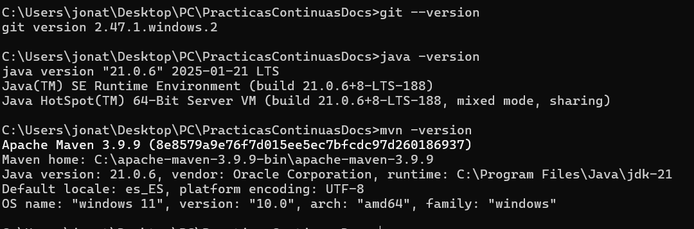
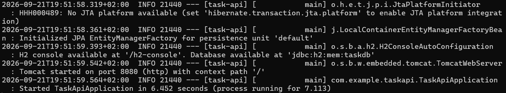
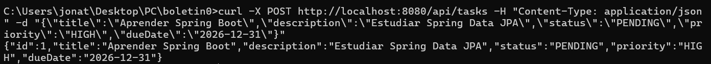
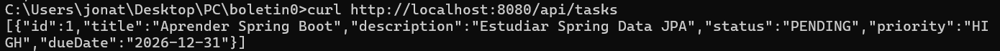
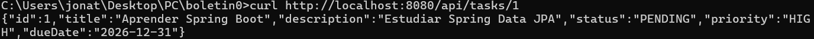
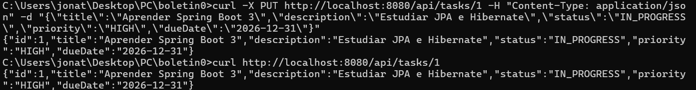
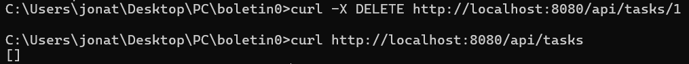
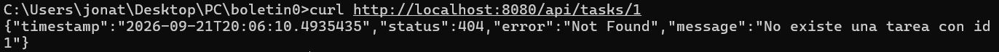
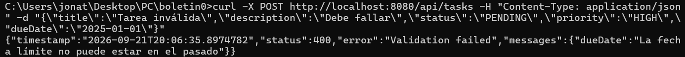

# Boletín 1

## Resumen de commits

| # | Mensaje del commit | Qué se hizo | Autor | Enlace |
|---|--------------------|-------------|-------|--------|
| 1 | `feat: ...`        | ...         | ...   | [abc1234](https://github.com/.../commit/abc1234) |

## Detalle por commit

### 1. `feat: ...`
- **Qué se hizo:** ...
- **Autor:** ...
- **Relación con el boletín:** apartado X ...
- **Uso de IA:** herramienta y prompt utilizado (o "no se ha usado").

## Descripción narrativa de lo hecho en la sesión y relación con los commits

### Parte A

Se ha comprobado la verificación del entorno de trabajo, que consiste en el verificar si las distintas herramientas se encuentran en la versión requerida, siendo las siguientes herramientas y versión las necesarias para trabajar:

- Git
- JDK 21
- Maven



### Parte B

Se le ha pedido a ChatGPT-5.6 Luna que nos haga el API Rest, usando el prompt proporcionado por el boletin.

>Genera un proyecto Maven con Spring Boot 3 y Java 21: una API REST de gestión de tareas (entidad Task con id, título, descripción, estado, prioridad y fecha límite). Usa Spring Data JPA con Hibernate para la persistencia y H2 en memoria como base de datos. Incluye endpoints CRUD, capa de servicio, repositorio JPA, validaciones con Bean Validation, manejo de errores con @RestControllerAdvice y tests unitarios con JUnit 5.

>Requisitos mínimos de la aplicación para considerarse “no trivial”:

>Al menos una entidad de dominio con varios campos y validaciones.
>Persistencia mediante Spring Data JPA/Hibernate.
>Operaciones CRUD completas (crear, leer, actualizar, borrar).
>Separación en capas (controlador / servicio / repositorio).
>Manejo de errores centralizado: un recurso inexistente devuelve 404, no una traza de excepción.
>Al menos 5 tests que comprueben reglas de negocio reales (p. ej. “no se puede crear una tarea con fecha límite pasada”), no simples assertNotNull.
>No debe incluir tests de integración que levanten el contexto de la aplicación y/o una base de datos. Solo debe incluir tests unitarios.
>El proyecto debe generar mediante mvn package un JAR ejecutable (fat JAR) que incluya todas las dependencias y pueda iniciarse mediante java -jar target/<nombre>.jar.

### Parte C

Tras esto, el proyecto se empaquetó utilizando el comando `mvn clean package`, y tras esto usando java, iniciamos la aplicacion utilizando el archivo jar generado mediante el comando `java -jar target/task-api-0.0.1-SNAPSHOT.jar`.



Una vez arrancada la API Rest en local con IP como `localhost` en el puerto `8080`, se realizo las pruebas con curl para comprobar su correcto funcionamiento en la URL: **http://localhost:8080**.

- Crear una tarea
```bash
curl -X POST http://localhost:8080/api/tasks -H "Content-Type: application/json" -d "{\"title\":\"Aprender Spring Boot\",\"description\":\"Estudiar Spring Data JPA\",\"status\":\"PENDING\",\"priority\":\"HIGH\",\"dueDate\":\"2026-12-31\"}"
```



- Listar las tareas
```bash
curl http://localhost:8080/api/tasks
```


- Obtener una tarea por ID
```bash
curl http://localhost:8080/api/tasks/1
```


- Actualizar una tarea
```bash
curl -X PUT http://localhost:8080/api/tasks/1 -H "Content-Type: application/json" -d "{\"title\":\"Aprender Spring Boot 3\",\"description\":\"Estudiar JPA e Hibernate\",\"status\":\"IN_PROGRESS\",\"priority\":\"HIGH\",\"dueDate\":\"2026-12-31\"}"
```


- Eliminar una tarea
```bash
curl -X DELETE http://localhost:8080/api/tasks/1
```


- Buscar una tarea que no existe
```bash
curl -i http://localhost:8080/api/tasks/1
```


- Crear una tarea con fecha limimte que ya ha pasado
```bash
curl -X POST http://localhost:8080/api/tasks -H "Content-Type: application/json" -d "{\"title\":\"Tarea inválida\",\"description\":\"Debe fallar\",\"status\":\"PENDING\",\"priority\":\"HIGH\",\"dueDate\":\"2025-01-01\"}"
```


<!-- Incluir capturas de pantalla de lo que no queda reflejado en commits -->