# Boletín 2

## Resumen de commits

| # | Mensaje del commit | Qué se hizo | Autor | Enlace |
|---|--------------------|-------------|-------|--------|
| 1 | `docs: gobernanza del repositorio`        | Se añadieron `CODEOWNERS`, plantillas de issues y PRs y `CONTRIBUTING.md`.         | Javier García Cutillas | [9d96a9e](https://github.com/jgarciacutillas/practicas-continuas-26-27/commit/9d96a9e0361bdf95e12494e5e7be419e8bf13c59) |
| 2 | `docs: arreglada las plantillas de las issues en github`        | Se corrigieron y configuraron las plantillas de bugs y mejoras.         | Javier García Cutillas | [66d9ef6](https://github.com/jgarciacutillas/practicas-continuas-26-27/commit/66d9ef6576ca8c44135dbec9a96892cf7fbdfaa1) |
| 3 | `chore: intento de push directo`        | Se hizo un cambio de prueba en `README.md` para comprobar la protección de `main`.         | Javier García Cutillas | [da009be](https://github.com/jgarciacutillas/practicas-continuas-26-27/commit/da009be3d3e7166e67f04c70ce3e28e84aae9099) |
| 4 | `feat(books): añadir estadísticas generales de libros`        | Se implementaron las estadísticas de libros y sus pruebas unitarias.         | Javier García Cutillas | [3e64630](https://github.com/jgarciacutillas/practicas-continuas-26-27/commit/3e6463093ae65daeb360e8f544aeeca2f05ecef5) |
| 5 | `feat(books): añadir endpoint de estadísticas`        | Se creó el endpoint `GET /api/books/stats`.         | Javier García Cutillas | [e7da52e](https://github.com/jgarciacutillas/practicas-continuas-26-27/commit/e7da52e57a666a9bf62f8bb88ef86bae911160b7) |
| 6 | `feat(book): añadimos un sistema de valoracion de libros` | Se creo los endpoints `GET /api/books/{id}/ratings` y `POST /api/books/{id}/ratings` | Jonathan Aleksander Llumitasig Chuquiana | [8ed891a](https://github.com/jgarciacutillas/practicas-continuas-26-27/commit/8ed891a5ecbb1c26369dd5988c2204c717a4729e) |
| 7 | `feat(task): campos createdAt y updatedAt creados` | Añade los campos `createdAt` y `updatedAt`. | Javier García Cutillas | [88ad632](https://github.com/jgarciacutillas/tasky/commit/88ad6326c8aebf175be4ab1f462c25f4fc82bb3a) |
| 8 | `test(task): verificación que los campos añadidos funcionan correctamente` | Añade tests para comprobar que `createdAt` y `updatedAt` se generan y actualizan correctamente. | Javier García Cutillas | [f375d1d](https://github.com/jgarciacutillas/tasky/commit/f375d1d266d9c7788b8d675e5fdaf7a578130e75) |
| 9 | `feat(task): campos createdUp y updatedAt creados en TaskResponse` | Añade `createdAt` y `updatedAt` a `TaskResponse` para incluir las fechas de auditoría en la respuesta de la API. | Jonathan Aleksander Llumitasig Chuquiana | [0f1fcaf](https://github.com/jgarciacutillas/tasky/commit/0f1fcafd7448776ff68293d2aac9bbae5f49d6a6) |
| 10 | `test(task): verificacion que los campos añadidos se ven en la respuesta` | Añade tests para comprobar que `createdAt` y `updatedAt` aparecen correctamente en las respuestas de la API. | Jonathan Aleksander Llumitasig Chuquiana | [dd0022c](https://github.com/jgarciacutillas/tasky/commit/dd0022c1258a9430c7b39f84fb03578f8dfa218e) |
| 11 | `refactor(task): cambios en el endpoint para consultar las estadisticas` | Se modificó el endpoint utilizado para consultar las estadísticas. | Jonathan Aleksander Llumitasig Chuquiana | [8621a9f](https://github.com/jgarciacutillas/practicas-continuas-26-27/commit/8621a9f1a77cf9eec5f93830d5f8ea983ce8a51c) |
| 12 | `refactor(task): cambio de endpoint de /stats a /librarystats para consultar las estadísticas` | Se cambió el endpoint `/stats` por `/librarystats` para consultar las estadísticas. | Javier García Cutillas | [868ee38](https://github.com/jgarciacutillas/practicas-continuas-26-27/commit/868ee38aabdceae00e0de2710191e724b5f54342) |


## Detalle por commit

### 1. `docs: gobernanza del repositorio`
- **Qué se hizo:** Se añadieron `CODEOWNERS`, plantillas de issues y PRs y `CONTRIBUTING.md`.
- **Autor:** Javier García Cutillas
- **Relación con el boletín:** Parte B (Gobernanza del repositorio)
- **Uso de IA:** No se ha usado

### 2. `docs: arreglada las plantillas de las issues en github`
- **Qué se hizo:** Se corrigieron las plantillas de bug y enhancement para que GitHub las reconociera como plantillas de issue.
- **Autor:** Javier García Cutillas
- **Relación con el boletín:** Parte B (Gobernanza del repositorio)
- **Uso de IA:** ChatGPT

#### Prompts
##### Prompt 1
```bash
Crear una plantilla en .md https://docs.github.com/en/communities/using-templates-to-encourage-useful-issues-and-pull-requests/about-issue-and-pull-request-templates
```

##### Prompt 2
```bash
De enhacement
```

### 3. `chore: intento de push directo`
- **Qué se hizo:** Se modificó el `README.md` para realizar un cambio directo sobre la rama protegida y comprobar la protección.
- **Autor:** Javier García Cutillas
- **Relación con el boletín:** Parte C (Proteger la rama main)
- **Uso de IA:** No se ha usado

### 4. `feat(books): añadir estadísticas generales de libros`
- **Qué se hizo:** Se creó `BookStatsResponse` y se añadió `getStats()` al servicio para calcular el total de libros, la media de páginas, los años de publicación y los libros agrupados por género. Además, se incorporaron pruebas para validar estos valores.
- **Autor:** Javier García Cutillas
- **Relación con el boletín:** Parte D (Trabajo por pull requests. Primer ciclo de PRs)
- **Uso de IA:** ChatGPT

#### Prompts
```markdown
Dividemelo en 2 commits y aplica el primero (solamente debes implementar lo que tienes en el primer commit y darme los archivos modificados para descargarlo. no hagas comprobaciones innecesarias yo te puedo informar si funciona o no): Resumen
Añadir un sistema de estadísticas generales de la biblioteca que permita consultar información agregada sobre los libros almacenados.
La API proporcionará un nuevo endpoint `GET /api/books/stats` que devolverá datos como el número total de libros, la media de páginas, el año de publicación más antiguo y más reciente, y la cantidad de libros por género.

## Problema o necesidad

Actualmente la API permite consultar y buscar libros individualmente, pero no existe una forma de obtener una visión general de la información almacenada en la biblioteca.
Esto dificulta conocer rápidamente datos como cuántos libros hay, cuál es la media de páginas o qué géneros tienen más libros, sin tener que consultar y procesar todos los libros manualmente.

## Solución propuesta

Crear un nuevo endpoint:
`GET /api/books/stats`
El endpoint devolverá información estadística calculada a partir de los libros almacenados.
Ejemplo de respuesta:

{
  "totalBooks": 42,
  "averagePages": 286.5,
  "oldestPublicationYear": 1954,
  "newestPublicationYear": 2026,
  "genreCounts": {
    "Fantasía": 12,
    "Ciencia ficción": 8,
    "Novela": 15,
    "Historia": 7
  }
}

Las estadísticas serán:

- `totalBooks` → número total de libros.
- `averagePages` → media de páginas de los libros.
- `oldestPublicationYear` → año de publicación más antiguo.
- `newestPublicationYear` → año de publicación más reciente.
- `genreCounts` → número de libros agrupados por género.

En caso de que no existan libros, `totalBooks` será `0` y las estadísticas que no puedan calcularse devolverán `null`.
La funcionalidad deberá incluir tests unitarios para comprobar el cálculo correcto de las estadísticas y el comportamiento cuando la biblioteca está vacía.

## Alternativas consideradas

Se han considerado otras funcionalidades como un sistema de favoritos, reservas de libros o un historial de préstamos.
Finalmente se propone implementar las estadísticas porque amplían la funcionalidad existente sin duplicar las funcionalidades de disponibilidad y valoración, y permiten añadir nuevas consultas y reglas de negocio manteniendo un alcance reducido.

## Beneficios

- Los usuarios podrán consultar rápidamente información general sobre la biblioteca.
- Se podrán conocer los géneros con mayor número de libros.
- La API ofrecerá información agregada sin necesidad de consultar todos los libros individualmente.
- La funcionalidad permitirá aprovechar los datos existentes en `Book` sin introducir nuevas entidades complejas.
- Facilita futuras funcionalidades relacionadas con paneles, informes o visualizaciones de la biblioteca.

## Prioridad sugerida

- Baja

  Media

  Alta

## Contexto adicional

La funcionalidad se integrará con la estructura actual de la API de libros y seguirá la arquitectura existente de `Controller`, `Service` y `Repository`.
El endpoint será independiente de las funcionalidades de valoración y disponibilidad ya existentes.
```

### 5. `feat(books): añadir endpoint de estadísticas`
- **Qué se hizo:** Se añadió al controlador el endpoint `GET /api/books/stats` que devuelve los datos calculados. De esta forma, la funcionalidad implementada en el commit anterior queda disponible a través de la API.
- **Autor:** Javier García Cutillas
- **Relación con el boletín:** Parte D (Trabajo por pull requests. Primer ciclo de PRs)
- **Uso de IA:** ChatGPT

#### Prompts
```bash
Dame la segunda parte y solo dame los archivos que has cambiado
```

### 6. `feat(book): añadimos un sistema de valoracion de libros`
- **Qué se hizo:** Se añadió al controlador el endpoint `GET /api/books/{id}/ratings` que devuelve la valoración media del libro con id cuyo valor es `id`, y también se añadió el endpoint `POST /api/books/{id}/ratings` que permite crear una valoración a un libro mediante su `id`.
- **Autor:** Jonathan Aleksander Llumitasig Chuquiana
- **Relación con el boletín:** Parte D (Trabajo por pull requests. Segundo ciclo de PRs)
- **Uso de IA:** ChatGPT

#### Prompts
```bash
  Edita el codigo para que cumpla esta funcionalidad:

## Resumen

Añadir un sistema de valoración de libros mediante el endpoint POST /api/books/{id}/ratings, permitiendo a los usuarios registrar una nota entre 1 y 5.

El libro almacenará la valoración media y el número total de votos recibidos. Además, se añadirá un endpoint para consultar la valoración de un libro y la búsqueda avanzada permitirá ordenar los libros por valoración.

## Problema o necesidad

Actualmente no existe una forma de conocer la valoración de los libros a partir de las opiniones de los usuarios.

Esto dificulta identificar rápidamente qué libros tienen una mejor valoración cuando se consultan o buscan varios libros.

Además, actualmente no existe un mecanismo específico para consultar la valoración media y el número de votos de un libro.

## Solución propuesta

Crear un nuevo endpoint:

POST /api/books/{id}/ratings

El endpoint recibirá una nota comprendida entre 1 y 5.
Ejemplo de petición:

{
"rating": 5
}

Cada vez que se registre una valoración:
Se incrementará el número de votos del libro.
Se actualizará la valoración media.
Se rechazará cualquier valoración inferior a 1 o superior a 5.
Se devolverá un error de validación cuando la nota no cumpla la regla establecida.
La búsqueda avanzada incorporará la posibilidad de ordenar los libros por su valoración media.

Además, se creará un endpoint para consultar la valoración actual de un libro:

GET /api/books/{id}/ratings

Este endpoint devolverá la valoración media y el número total de votos.

Ejemplo de respuesta:

{
"averageRating": 4.3,
"ratingCount": 25
}

La información almacenada en el libro será:

mediaRating → valoración media
totalRatings → número de votos

La búsqueda avanzada incorporará la posibilidad de ordenar los libros por su valoración media.

## Alternativas consideradas

No se consideraron otras alternativas.

## Beneficios

- Los usuarios podrán valorar los libros de forma sencilla.
- Los usuarios podrán identificar libros con mejores valoraciones.
- La búsqueda avanzada será más útil al permitir ordenar los resultados por valoración.
- La API dispondrá de una funcionalidad adicional con una entidad y una regla de validación sencilla.
- La funcionalidad puede probarse fácilmente mediante tests unitarios y peticiones HTTP.

## Prioridad sugerida

- Baja

  Media

  Alta

## Contexto adicional

Endpoint para registrar una valoración:

POST /api/books/{id}/ratings

Ejemplo:

POST /api/books/12/ratings
Content-Type: application/json
{
"rating": 4
}

Endpoint para consultar la valoración de un libro:

GET /api/books/{id}/ratings

Ejemplo:

GET /api/books/12/ratings

Respuesta:
{
"averageRating": 4.3,
"ratingCount": 25
}

Las valoraciones válidas estarán comprendidas entre 1 y 5, ambas incluidas.
La búsqueda avanzada permitirá ordenar los libros por valoración media.
```

### 7. `feat(task): campos createdAt y updatedAt creados`
- **Qué se hizo:** Añade los campos `createdAt` y `updatedAt` a la entidad `Task` para registrar cuándo se crea y modifica una tarea.
- **Autor:** Javier García Cutillas
- **Relación con el boletín:** Parte F (PR con fork)
- **Uso de IA:** ChatGPT

#### Prompts
```bash
# **[FEAT] Añadir campos de auditoría de tiempos #5**

**IssueOpen**

## Description

[@hsanchezm7](https://github.com/hsanchezm7) ([image](https://avatars.githubusercontent.com/u/61797804?u=ad5222ef10442716bbd00f72af362cbed390b14c\&v=4\&size=48))

[**hsanchezm7**](https://github.com/hsanchezm7)

opened [1m ago](https://github.com/hsanchezm7/tasky/issues/5#issue-5618587677)

**Owner**

## ¿Qué problema resuelve?

Actualmente, el modelo `Task` no registra metadatos temporales de creación ni de última modificación. Esto genera los siguientes inconvenientes:

1. **Falta de trazabilidad:** No es posible saber cuándo se creó una tarea ni cuándo se produjo su último cambio de estado o contenido.
2. **Imposibilidad de ordenar cronológicamente:** No se pueden consultar las tareas más recientes o modificadas recientemente sin basarse en el `id` autogenerado (que no refleja actualizaciones).
3. **Mantenimiento y soporte:** Dificulta la depuración de problemas de negocio al no disponer de una marca temporal del ciclo de vida del recurso.

## Propuesta de mejora

Incorporar auditoría automática en JPA/Hibernate mediante dos campos de tipo `LocalDateTime`:

- `createdAt`: se asigna automáticamente al persistir la entidad por primera vez y no puede modificarse (`updatable = false`).
- `updatedAt`: se asigna al crear la entidad y se actualiza de forma automática en cada modificación posterior.

Ambos campos deben exponerse en el DTO de salida (`TaskResponse`) para que los clientes del API puedan consumirlos.

## Prioridad

- Baja

  Media

  Alta

## Comprobaciones

- He buscado Issues duplicados

separa esto en 2 commits y aplica el primero. solamente dame los archivos que has modificado.
```

### 8. `test(task): verificación que los campos añadidos funcionan correctamente`
- **Qué se hizo:** Añade tests para comprobar que `createdAt` y `updatedAt` se generan y actualizan correctamente.
- **Autor:** Javier García Cutillas
- **Relación con el boletín:** Parte F (PR con fork)
- **Uso de IA:** ChatGPT

#### Prompts
```bash
hazme el segundo commit
```

### 9. `feat(task): campos createdUp y updatedAt creados en TaskResponse`
- **Qué se hizo:** Añade `createdAt` y `updatedAt` a `TaskResponse` para incluir las fechas de auditoría en la respuesta de la API.
- **Autor:** Jonathan Aleksander Llumitasig Chuquiana
- **Relación con el boletín:** Parte F (PR con fork)
- **Uso de IA:** ChatGPT

#### Prompts
```bash
Una división equilibrada sería separar **modelo/auditoría JPA** de **DTO/API y validación**, con 2 commits por persona.

| Persona       | Commit                                                       | Trabajo                                                                                                                                                                                   |
| ------------- | ------------------------------------------------------------ | ----------------------------------------------------------------------------------------------------------------------------------------------------------------------------------------- |
| **Persona 1** | **1. `feat(task): add createdAt and updatedAt fields`**      | Añadir `createdAt` y `updatedAt` como `LocalDateTime` en `Task`. Configurar la auditoría automática con JPA/Hibernate. `createdAt` debe ser de solo lectura mediante `updatable = false`. |
| **Persona 1** | **2. `test(task): verify automatic timestamp auditing`**     | Añadir/actualizar tests para comprobar que al crear una tarea se rellenan ambos campos y que `updatedAt` cambia al modificarla mientras `createdAt` permanece igual.                      |
| **Persona 2** | **3. `feat(task): expose audit timestamps in TaskResponse`** | Añadir `createdAt` y `updatedAt` a `TaskResponse` y adaptar el mapeo entre `Task` y `TaskResponse`.                                                                                       |
| **Persona 2** | **4. `test(task): verify audit fields in API response`**     | Añadir/actualizar tests de controller/service para comprobar que ambos timestamps aparecen correctamente en la respuesta del API.                                                         |

### Reparto

**Persona 1 — Persistencia**

* `Task`
* Configuración de auditoría JPA/Hibernate
* Tests de persistencia/actualización

**Persona 2 — API**

* `TaskResponse`
* Mapeos
* Tests de respuesta del API

Así los **4 commits quedan independientes, ordenados y fáciles de revisar**:

1. feat(task): add createdAt and updatedAt fields
2. test(task): verify automatic timestamp auditing
3. feat(task): expose audit timestamps in TaskResponse
4. test(task): verify audit fields in API response

El orden recomendado sería **1 → 2 → 3 → 4**, porque el DTO y sus tests dependen de que los campos existan primero en `Task`.


Como harias los commits 3 y 4, teniendo en cuenta que ya se hizo los primeros dos commits, mostrandome los cambios que has hecho en cada archivo?
```

### 10. `test(task): verificacion que los campos añadidos se ven en la respuesta`
- **Qué se hizo:** Añade tests para comprobar que `createdAt` y `updatedAt` aparecen correctamente en las respuestas de la API.
- **Autor:** Jonathan Aleksander Llumitasig Chuquiana
- **Relación con el boletín:** Parte F (PR con fork)
- **Uso de IA:** ChatGPT

#### Prompts
```bash
Una división equilibrada sería separar **modelo/auditoría JPA** de **DTO/API y validación**, con 2 commits por persona.

| Persona       | Commit                                                       | Trabajo                                                                                                                                                                                   |
| ------------- | ------------------------------------------------------------ | ----------------------------------------------------------------------------------------------------------------------------------------------------------------------------------------- |
| **Persona 1** | **1. `feat(task): add createdAt and updatedAt fields`**      | Añadir `createdAt` y `updatedAt` como `LocalDateTime` en `Task`. Configurar la auditoría automática con JPA/Hibernate. `createdAt` debe ser de solo lectura mediante `updatable = false`. |
| **Persona 1** | **2. `test(task): verify automatic timestamp auditing`**     | Añadir/actualizar tests para comprobar que al crear una tarea se rellenan ambos campos y que `updatedAt` cambia al modificarla mientras `createdAt` permanece igual.                      |
| **Persona 2** | **3. `feat(task): expose audit timestamps in TaskResponse`** | Añadir `createdAt` y `updatedAt` a `TaskResponse` y adaptar el mapeo entre `Task` y `TaskResponse`.                                                                                       |
| **Persona 2** | **4. `test(task): verify audit fields in API response`**     | Añadir/actualizar tests de controller/service para comprobar que ambos timestamps aparecen correctamente en la respuesta del API.                                                         |

### Reparto

**Persona 1 — Persistencia**

* `Task`
* Configuración de auditoría JPA/Hibernate
* Tests de persistencia/actualización

**Persona 2 — API**

* `TaskResponse`
* Mapeos
* Tests de respuesta del API

Así los **4 commits quedan independientes, ordenados y fáciles de revisar**:

1. feat(task): add createdAt and updatedAt fields
2. test(task): verify automatic timestamp auditing
3. feat(task): expose audit timestamps in TaskResponse
4. test(task): verify audit fields in API response

El orden recomendado sería **1 → 2 → 3 → 4**, porque el DTO y sus tests dependen de que los campos existan primero en `Task`.


Como harias los commits 3 y 4, teniendo en cuenta que ya se hizo los primeros dos commits, mostrandome los cambios que has hecho en cada archivo?
```

### 11. `refactor(task): cambios en el endpoint para consultar las estadisticas`
- **Qué se hizo:** Se modificó el endpoint utilizado para consultar las estadísticas con el objetivo de generar un conflicto de PRs.
- **Autor:** Jonathan Aleksander Llumitasig Chuquiana
- **Relación con el boletín:** Parte E (Provocar un conflicto en un PR)
- **Uso de IA:** No se ha usado

### 12. `refactor(task): cambio de endpoint de /stats a /librarystats para consultar las estadísticas`
- **Qué se hizo:** Se cambió el endpoint `/stats` por `/librarystats` para consultar las estadísticas con el objetivo de generar un conflicto de PRs
- **Autor:** Javier García Cutillas
- **Relación con el boletín:** Parte E (Provocar un conflicto en un PR)
- **Uso de IA:** No se ha usado

## Descripción narrativa de lo hecho en la sesión y relación con los commits

### Parte A (Publicar el repositorio)
Se ha creado un nuevo repositorio remoto en GitHub, se ha añadido como colaborador a la pareja y se ha conectado el repositorio local con el remoto realizando el primer push.

```bash
git remote add origin https://github.com/jgarciacutillas/practicas-continuas-26-27.git
git branch -M main
git push -u origin main
```

### Parte B (Gobernanza del repositorio)
Antes de realizar contribuciones y PRs hay que preparar el repositorio para un desarrollo colaborativo eficiente y eficaz para ello se deben realizar plantillas para que todas las funcionalidades tengan el mismo aspecto.

#### Plantilla para las pull requests (PRs):

```markdown
## Qué hace este PR

Closes #

## Cómo lo he probado

- [ ] Tests unitarios nuevos o actualizados
- [ ] Probado manualmente con curl / navegador

## Notas para quien revise

<!-- decisiones discutibles, alternativas descartadas, dudas -->
```

#### Plantilla para nuevas funcionalidades:

```markdown
## Resumen
Describe de forma clara y concisa la mejora que propones.

## Problema o necesidad
¿Qué problema resuelve o qué necesidad cubre? Por ejemplo: "Me resulta molesto cuando ...".

## Solución propuesta
Describe cómo te gustaría que funcionara.

## Alternativas consideradas
Otras soluciones o funcionalidades que hayas valorado.

## Beneficios
- Quién se beneficiaría de este cambio
- Qué mejora aportaría

## Prioridad sugerida
- [ ] Baja
- [ ] Media
- [ ] Alta

## Contexto adicional
Añade capturas, maquetas, enlaces o cualquier otra información relevante.
```

#### Plantilla para bugs:

```markdown
## Descripción del error
Describe de forma clara y concisa cuál es el problema.

## Pasos para reproducirlo
1. Ir a '...'
2. Hacer clic en '...'
3. Desplazarse hasta '...'
4. Ver el error

## Comportamiento esperado
Describe qué esperabas que ocurriera.

## Capturas de pantalla
Si aplica, añade capturas para explicar el problema.

## Entorno
- SO: [p. ej. Windows 11, macOS 14, Ubuntu 24.04]
- Navegador / versión: [p. ej. Chrome 130]
- Versión del proyecto: [p. ej. 1.2.3]

## Contexto adicional
Añade cualquier otra información relevante (logs, enlaces, etc.).
```

Se deben definir los propietarios del código en un archivo llamado `CODEOWNERS`:

```bash
# Toda la aplicación la revisa el equipo
*               @jgarciacutillas @jona-llc
```

Se ha utilizado la estrategia de fusión del PR por defecto el merge commit:

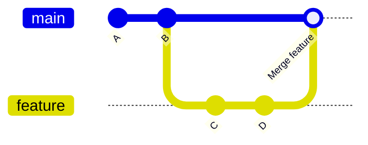

Se ha creado un archivo (`CONTRIBUTING.md`) con instrucciones para contribuir al proyecto.

### Parte C (Proteger la rama main)

#### Configuración de la regla
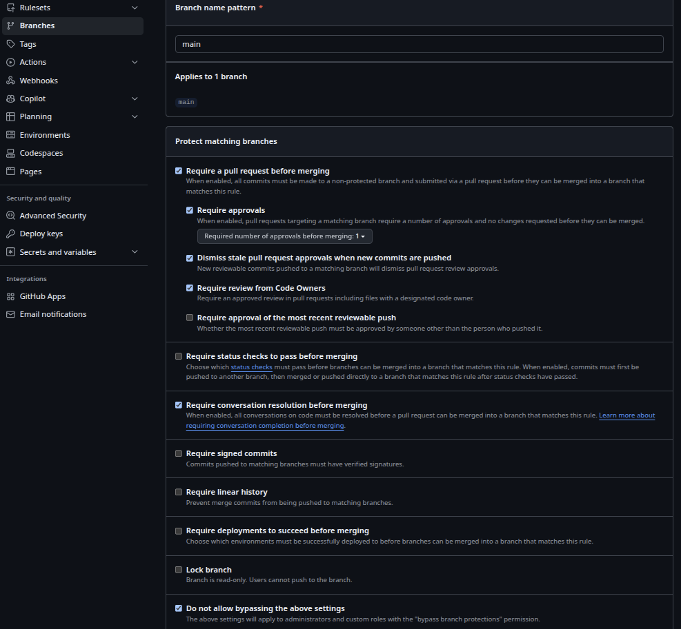

#### Comprobación de la regla
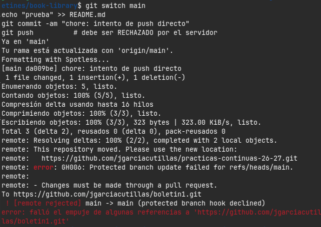

### Parte D (Trabajo por Pull Requests)

#### Primer ciclo de PRs

##### Issue
Se ha creado la primera issue llamada "[añadir estadísticas generales de la biblioteca](https://github.com/jgarciacutillas/practicas-continuas-26-27/issues/4)" que permite obtener datos generales y básicos sobre la biblioteca y los libros.

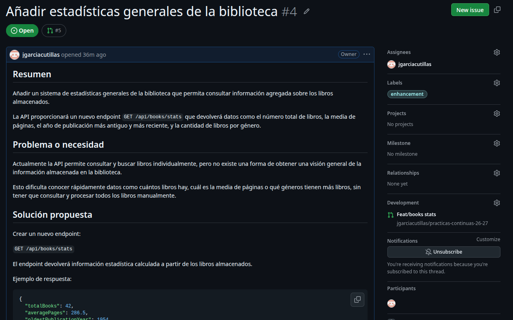

##### Rama de feature e implementación del cambio
Se ha creado la rama `feat/books-stats` para realizar la implementación de la nueva funcionalidad.
Se ha realizado en 2 commits:
- [feat(books): añadir estadísticas generales de libros](https://github.com/jgarciacutillas/practicas-continuas-26-27/commit/3e6463093ae65daeb360e8f544aeeca2f05ecef5)
- [feat(books): añadir endpoint de estadísticas](https://github.com/jgarciacutillas/practicas-continuas-26-27/commit/e7da52e57a666a9bf62f8bb88ef86bae911160b7)

##### PR, revisión y fusión
En esta última fase se abre la pull request, se recibe la revisión para mejorar la funcionalidad realizando una discusión objetiva y, finalmente, se fusiona la pull request con la estrategia `merge commit` y se borra la rama.

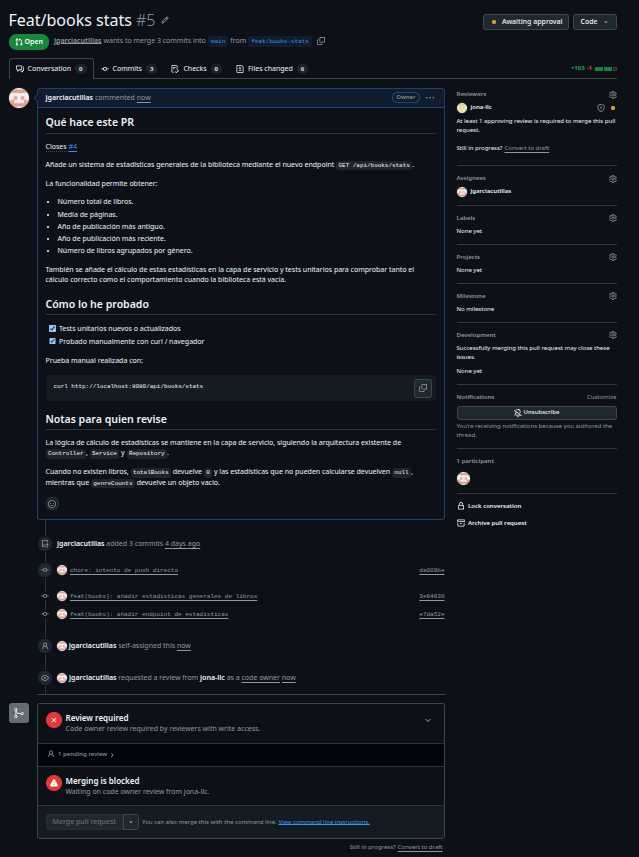

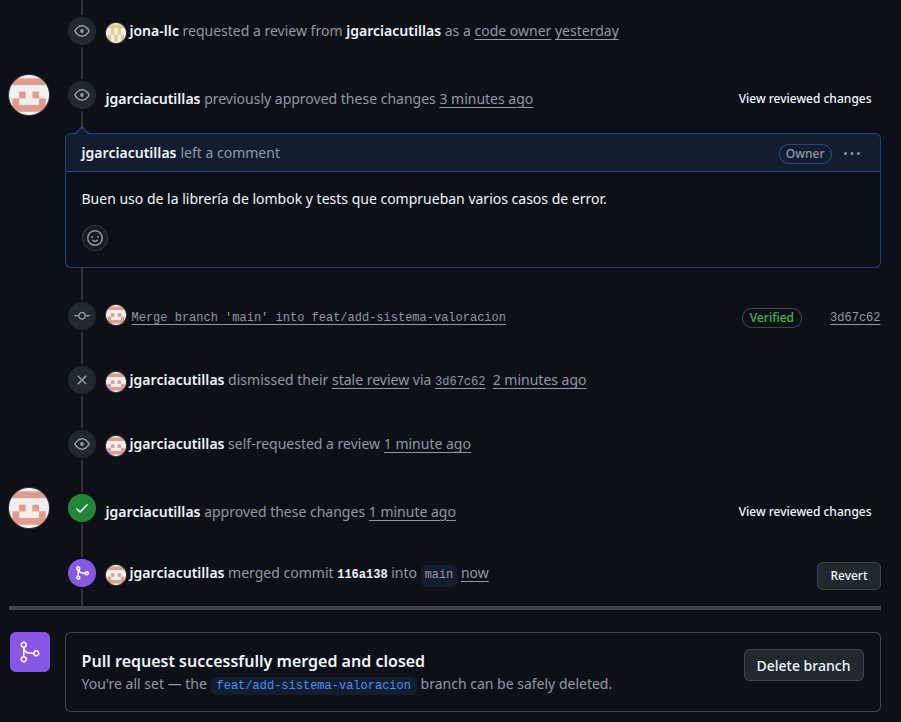

#### Segundo ciclo de PRs

##### Issue
Se ha creado la segunda issue llamada que permite añadir un sistema de valoracion para los libros de la bibioteca, tanto añadir una valoracion como consultar las valoraciones media y el numero de valoraciones de un libro en concreto.

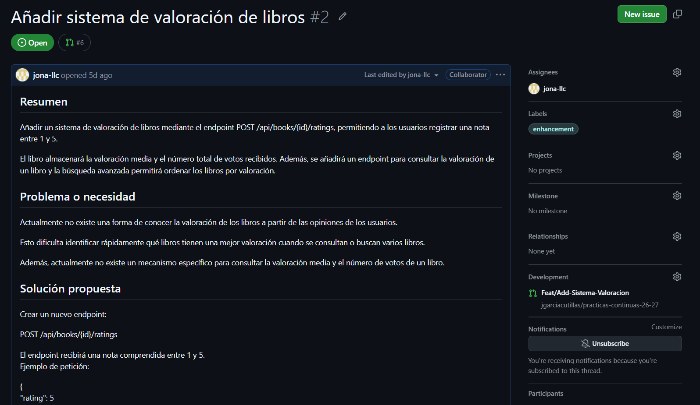

##### Rama de feature e implementación del cambio
Se ha creado la rama `feat/add-sistema-valoracion` para realizar la implementación de la nueva funcionalidad.
Se ha realizado un solo commit:
- [feat(book): añadimos un sistema de valoracion de libros](https://github.com/jgarciacutillas/practicas-continuas-26-27/commit/8ed891a5ecbb1c26369dd5988c2204c717a4729e) 

##### PR, revisión y fusión
En esta ultima fase se abre el pull request, se recibe la revisión para mejorar la funcoinalidad realizando una discusión objetiva. Finalmente, se fusiona la pull request con la estrategia `merge commit` y se borra la rama.

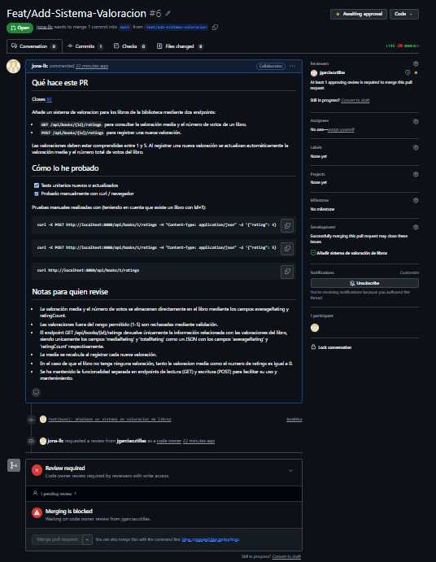

Una vez fusionado la rama de la funcionalidad realizada con la rama principal, borramos la rama creada para la funcionalidad, haciendo esta tarea la persona encargada de realizar la revisión y fusión.

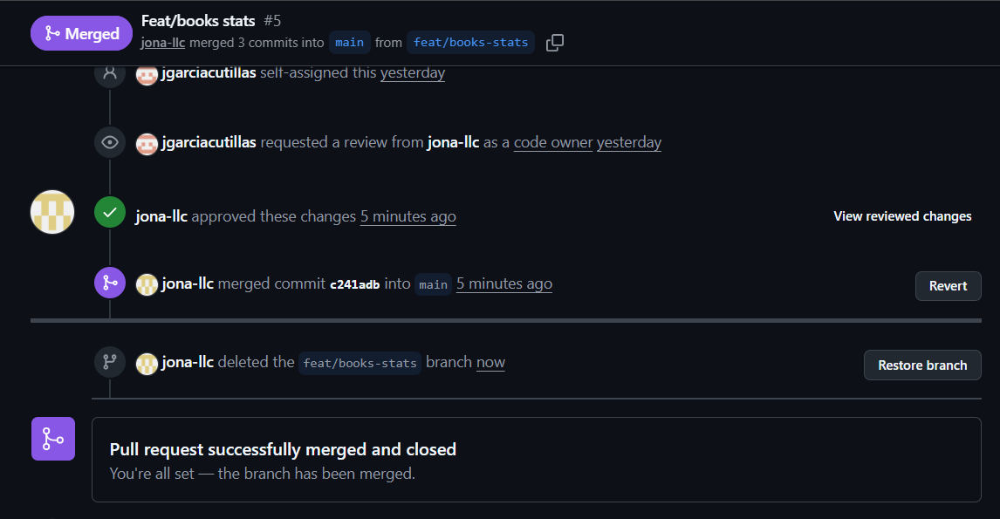

### Parte E (Provocar un conflicto en un PR)
Para provocar un conflicto en un PR se han creado 2 ramas llamadas `refactor/endpoint-stats` y `refactor/get-endpoint-stats`. Se ha realizado el cambio en la misma línea y, posteriormente, la primera se ha fusionado vía PR.

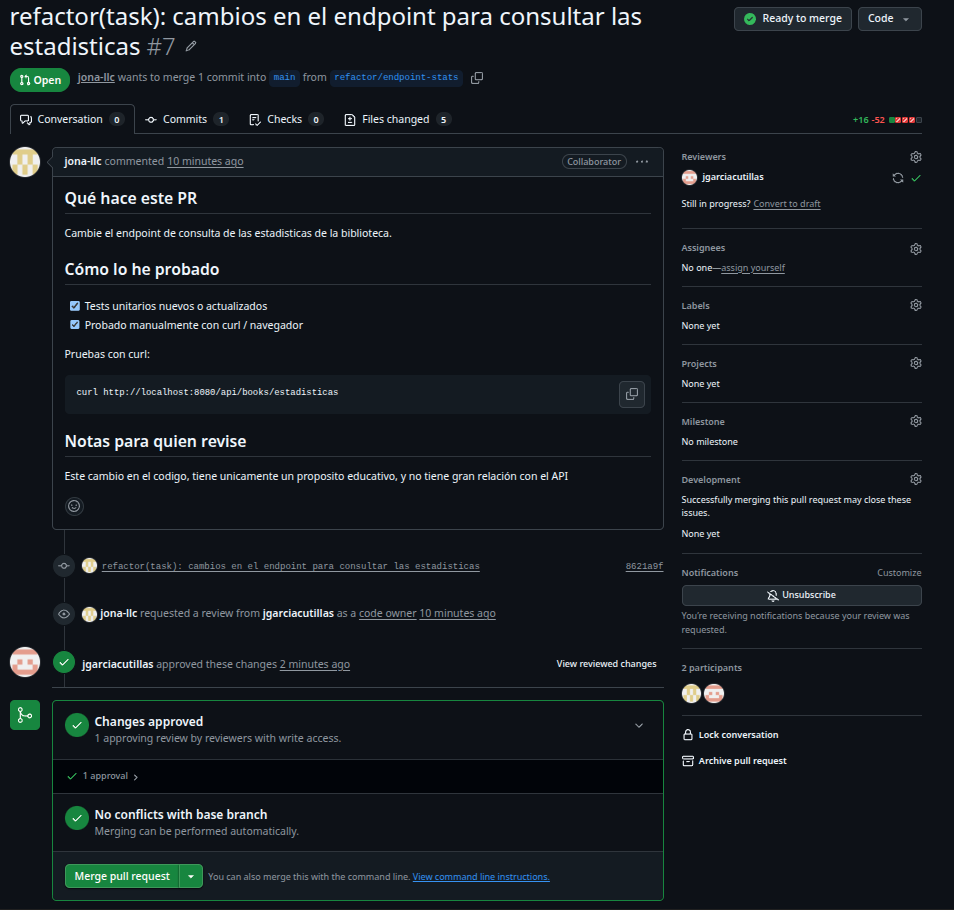

Se crea la segunda PR y se observa que existe un conflicto:

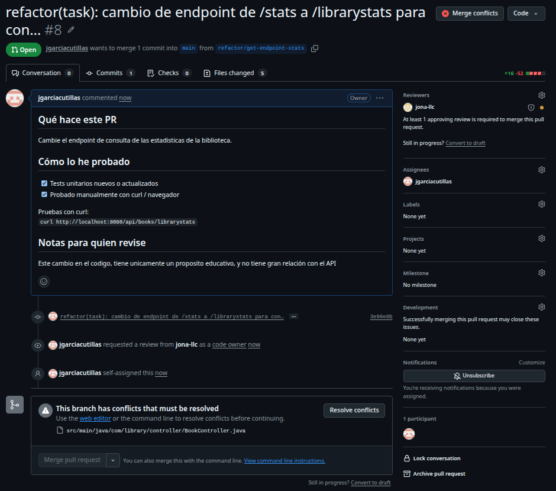

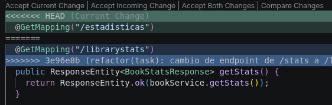

Se resuelve el conflicto y se observa que la PR ya permite fusionarse con main.

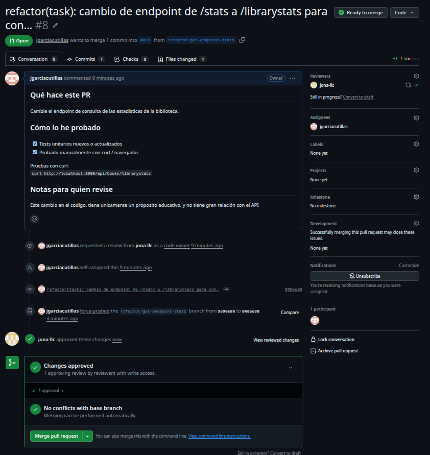

### Parte F (PR con fork)
Se creo un Issue no trivial especificando una funcionalidad relacionada con la disponibilidad de los libros de la biblioteca (para la otra pareja)

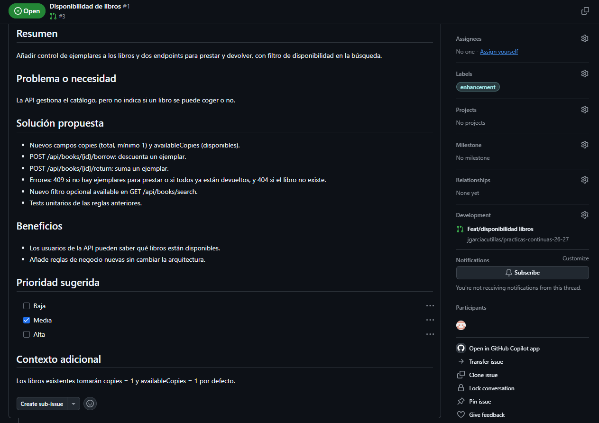

En la issue de Tasky (el repositorio de la otra pareja) se pedía añadir campos de auditoría ([issue](https://github.com/hsanchezm7/tasky/issues/5) y [pull request](https://github.com/hsanchezm7/tasky/pull/8)).

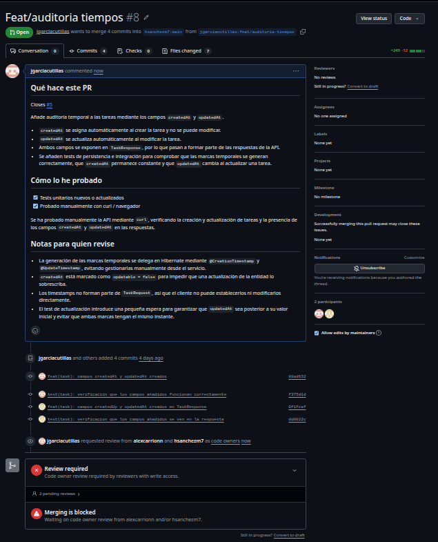