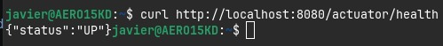
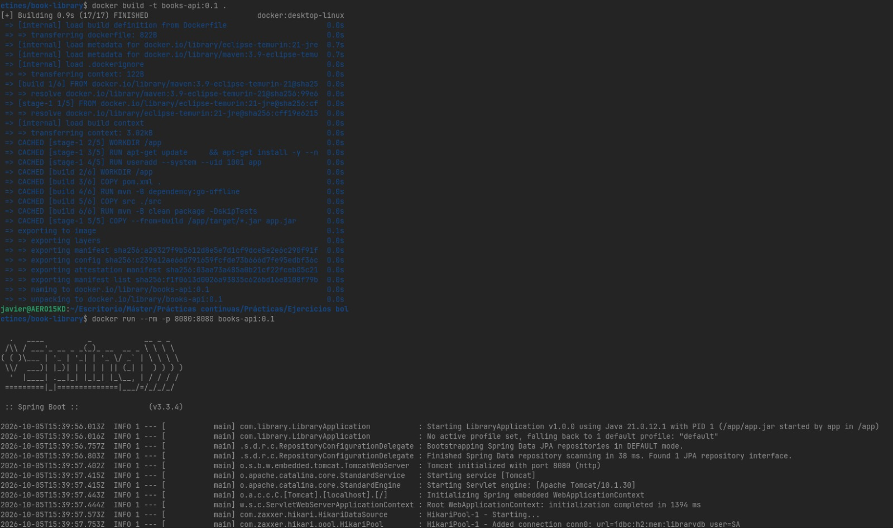
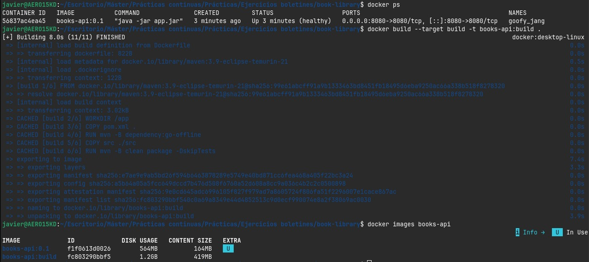
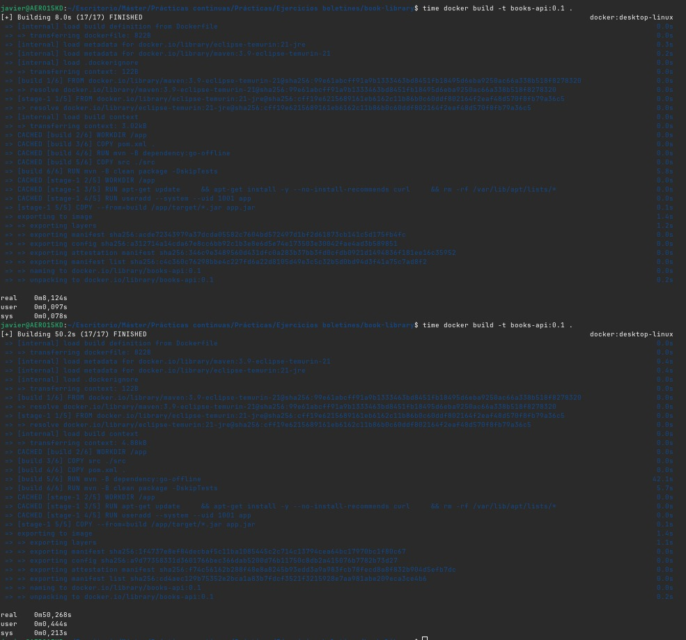
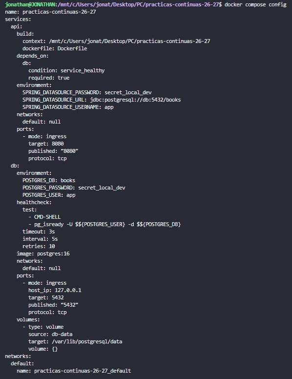
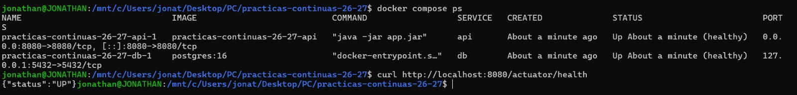
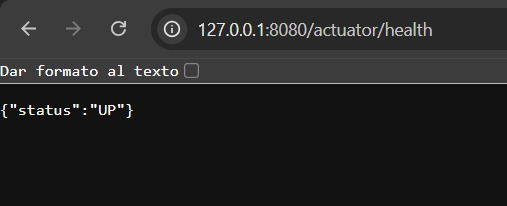
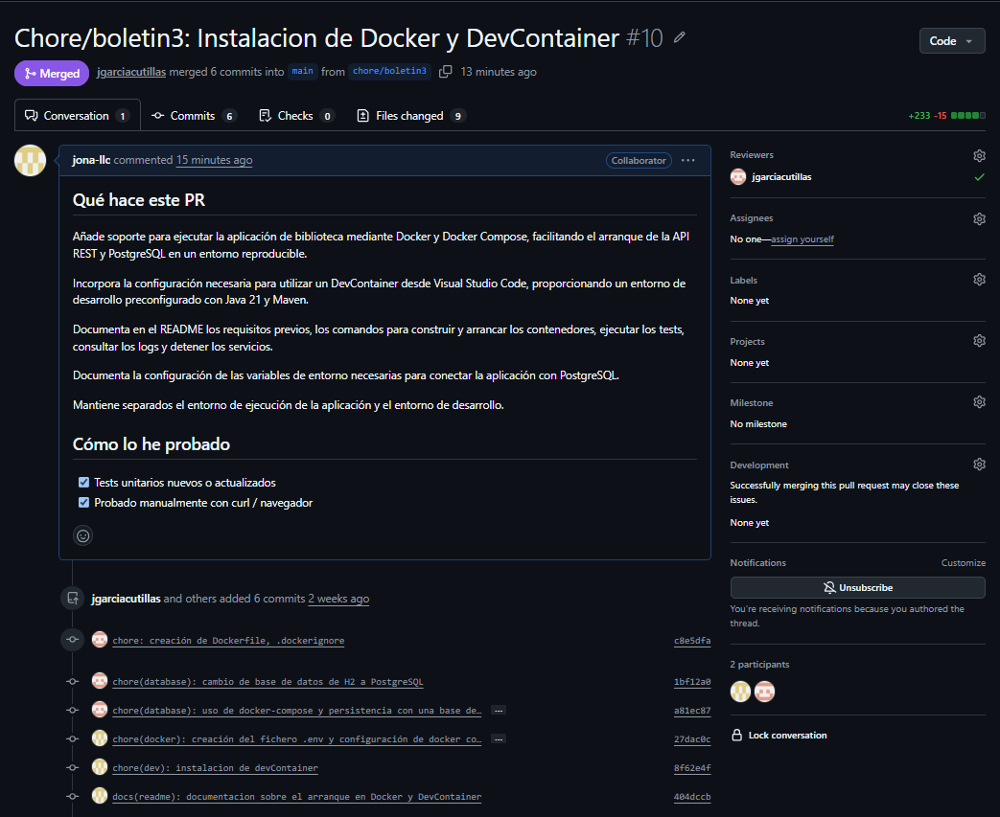
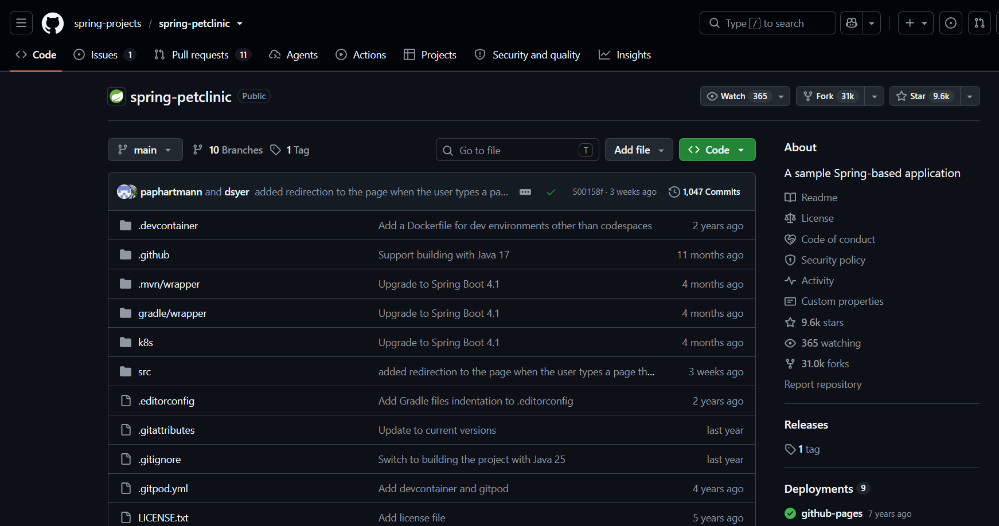

# Boletin 3

## Resumen de commits

| # | Mensaje del commit | Qué se hizo | Autor | Enlace |
|---|--------------------|-------------|-------|--------|
| 1 | `chore(build): uso de spring boot actuator para conocer si el servicio está activo` | Se añadió el uso de Spring Boot Actuator | Javier García Cutillas | [501b754](https://github.com/jgarciacutillas/practicas-continuas-26-27/commit/501b754b724ebaf3177d664179c8fa88192af5e9) |
| 2 | `chore: creación de Dockerfile, .dockerignore` | Se creó el fichero Dockerfile y .dockerignore | Javier García Cutillas | [c8e5dfa](https://github.com/jgarciacutillas/practicas-continuas-26-27/commit/c8e5dfaa7648c9521f55f68d3e9f0cc410e2a532) |
| 3 | `chore(database): cambio de base de datos de H2 a PostgreSQL` | Se cambio la base de datos usada por la aplicación a PostgreSQL | Javier García Cutillas | [1bf12a0](https://github.com/jgarciacutillas/practicas-continuas-26-27/commit/1bf12a0b2f5eb965d34c0d7c4b44ca024190888d) |
| 4 | `chore(database): uso de docker-compose y persistencia con una base de datos postgresql` | Se creó y usó `docker-compose` junto a PostgreSQL | Javier García Cutillas | [a81ec87](https://github.com/jgarciacutillas/practicas-continuas-26-27/commit/a81ec87c6457ccdc0fe46d03c893d71891973d64) |
| 5 | `chore(docker): creación del fichero .env y configuración de docker compose` | Creación del archivo `.env` sin versionar para que sustituya las expresiones `${VARIABLE}` para utilizar las credenciales  | Jonathan Aleksander Llumitasig Chuquiana | [27dac0c](https://github.com/jgarciacutillas/practicas-continuas-26-27/commit/27dac0c89dd60ad7242ea555e4483dc086952eec) |
| 6 | `chore(dev): instalacion de devContainer` | Instalación de Dev Container | Jonathan Aleksander Llumitasig Chuquiana | [8f62e4f](https://github.com/jgarciacutillas/practicas-continuas-26-27/commit/8f62e4fd73f667e1065271a6f857244bee3702ff) |
| 7 | `docs(readme): documentacion sobre el arranque en Docker y DevContainer` | Documentacion sobre arranque con Docker y DevContainer | Jonathan Aleksander Llumitasig Chuquiana | [404dccb](https://github.com/jgarciacutillas/practicas-continuas-26-27/commit/404dccb1b5219fc2399bf46850ca4a51e1600b0f) |


## Detalle por commit

### 1. `chore(build): uso de spring boot actuator para conocer si el servicio está activo`
- **Qué se hizo:** Se añadio al `pom.xml` las dependencias necesarias y se añadió al fichero `application.properties` las propiedades necesarias para el correcto funcionamiento. 
- **Autor:** Javier García Cutillas
- **Relación con el boletín:** Parte B - Endpoint de salud.
- **Uso de IA:** No se ha usado


### 2. `chore: creación de Dockerfile, .dockerignore`
- **Qué se hizo:** Se creó los ficheros `Dockerfile` para la construcción del contenedor, asi como los distintos entornos para obtener las dependencias necesarias para crear el contenedor final, además de la creación de `.dockerignore` para indicarle al contenedor que ficheros debe ignorar. 
- **Autor:** Javier García Cutillas
- **Relación con el boletín:** Parte C - Dockerfile multi-stage.
- **Uso de IA:** No se ha usado

### 3. `chore(database): cambio de base de datos de H2 a PostgreSQL`
- **Qué se hizo:** Se hicieron cambios en la aplicación para que dejara de usar una base de datos en memoria (H2) y que usara una base de datos PostgreSQL. 
- **Autor:** Javier García Cutillas
- **Relación con el boletín:** Parte D - De H2 a PostgreSQL con Compose.
- **Uso de IA:** ChatGPT

#### Prompt
```bash
Modifica ligeramente el proyecto existente para sustituir la base de datos H2 en memoria por PostgreSQL, manteniendo Spring Data JPA con Hibernate como capa de persistencia.
```

### 4. `chore(database): uso de docker-compose y persistencia con una base de datos postgresql`
- **Qué se hizo:** Creación y uso del `docker-compose.yaml` junto al uso de PostgreSQL como dos contenedores distintos pero relacionados.
- **Autor:** Javier García Cutillas
- **Relación con el boletín:** Parte D - De H2 a PostgreSQL con Compose.
- **Uso de IA:** No se ha usado

### 5. `chore(docker): creación del fichero .env y configuración de docker compose`
- **Qué se hizo:** Creación del archivo `.env` en local (sin versionar en git ni se guarde en el contenedor) para que sustituya en `docker-compose.yml` las expresiones `${VARIABLE}` para utilizar las credenciales.
- **Autor:** Jonathan Aleksander Llumitasig Chuquiana
- **Relación con el boletín:** Parte E - Sacar la configuración a un fichero `.env`
- **Uso de IA:** No se ha usado

### 6. `chore(dev): instalacion de devContainer`
- **Qué se hizo:** Instalación y uso de Dev container para definir un entorno de desarrollo como código.
- **Autor:** Jonathan Aleksander Llumitasig Chuquiana
- **Relación con el boletín:** Parte F - Dev container
- **Uso de IA:** No se ha usado

### 7. `docs(readme): documentacion sobre el arranque con Docker y DevContainer`
- **Qué se hizo:** Se documento como arrancar la API con Docker y/o con DevContainer.
- **Autor:** Jonathan Aleksander Llumitasig Chuquiana
- **Relación con el boletín:** Parte G - Versionar los cambios
- **Uso de IA:** ChatGPT

```bash
\# Biblioteca de libros

API REST sencilla de una biblioteca, construida con Spring Boot 3, Java 21, Spring Data JPA, Hibernate y PostgreSQL. El proyecto está diseñado para cumplir los requisitos de una aplicación no trivial sin introducir complejidad innecesaria.

\## Requisitos

\- Java 21
\- Maven 3.9+

\## Arquitectura

La aplicación está separada en capas:

\- \`controller\`: endpoints REST.
\- \`service\`: reglas de negocio.
\- \`repository\`: persistencia con Spring Data JPA.
\- \`dto\` y \`mapper\`: entrada/salida y transformación.
\- \`exception\`: errores y manejo centralizado.

\## Dominio

Cada libro tiene varios atributos: título, autor, género, ISBN, año de publicación y número de páginas.

Validaciones de entrada:

\- título y autor obligatorios;
\- género obligatorio;
\- ISBN opcional, pero si se informa debe tener 10 o 13 dígitos;
\- año entre 1450 y 2100;
\- páginas entre 1 y 10000.

Reglas de negocio adicionales:

\- no se permite repetir un ISBN;
\- no se permite un año de publicación futuro;
\- al actualizar, un ISBN que pertenece al mismo libro sigue siendo válido;
\- un libro inexistente provoca \`404 NOT_FOUND\`.

\## CRUD

\- \`POST /api/books\`
\- \`GET /api/books\`
\- \`GET /api/books/{id}\`
\- \`PUT /api/books/{id}\`
\- \`DELETE /api/books/{id}\`

\## Errores

\`GlobalExceptionHandler\` centraliza los errores. Un recurso inexistente devuelve HTTP 404; datos inválidos devuelven 400 y un ISBN duplicado devuelve 409.

\## Tests unitarios

La suite contiene 15 tests unitarios en total:

\- reglas de negocio del servicio: ISBN duplicado al crear, año futuro, ISBN duplicado al actualizar, mismo ISBN permitido al actualizar, recurso inexistente en lectura, actualización y borrado, y borrado correcto;
\- manejo centralizado de errores: 404 para libro inexistente y 400 para una regla de negocio inválida;
\- validaciones de DTO: título obligatorio, ISBN con 10/13 dígitos, páginas positivas y año mínimo.

La suite mantiene los tests unitarios y un test de repositorio con \`@DataJpaTest\`. Este último usa H2 únicamente en test para no requerir un PostgreSQL externo durante \`mvn test\`; la aplicación en ejecución utiliza exclusivamente PostgreSQL.

\## Empaquetado ejecutable

El proyecto usa \`spring-boot-maven-plugin\`, que genera un JAR ejecutable con las dependencias incluidas.

\`\`\`bash
mvn clean package
java -jar target/book-library.jar
\`\`\`

La aplicación utiliza PostgreSQL como base de datos persistente. La conexión se configura mediante \`DB_URL\`, \`DB_USERNAME\` y \`DB_PASSWORD\`, con estos valores por defecto para desarrollo local:

\`\`\`text
DB_URL=jdbc:postgresql://localhost:5432/librarydb
DB_USERNAME=library
DB_PASSWORD=library
\`\`\`

Hibernate mantiene el esquema actualizado mediante \`spring.jpa.hibernate.ddl-auto=update\`.

La ampliación añade 5 tests unitarios al conjunto existente.

\## Búsqueda avanzada

Además del CRUD existente, la API incorpora un endpoint de búsqueda paginada:

\- \`GET /api/books/search\`
\- filtros opcionales: \`keyword\`, \`author\`, \`genre\`, \`minYear\`, \`maxYear\` y \`available\` (\`true\` devuelve los libros con ejemplares disponibles y \`false\` los que no tienen ninguno);
\- paginación mediante \`page\` y \`size\` solamente 100 resultados por página (máximo);
\- ordenación mediante \`sort\`, por ejemplo \`title,asc\`, \`author,desc\` o \`publishedYear,desc\`.

Los filtros de texto no distinguen entre mayúsculas y minúsculas y se pueden combinar. El servicio valida el rango de años, el tamaño de página y los campos de ordenación permitidos antes de consultar el repositorio.

La respuesta de búsqueda usa un DTO propio para mantener estable el contrato JSON y no exponer directamente la estructura interna de \`PageImpl\` de Spring Data.

\## Hooks

Para que lance el hook de formateo automático debes ejecutar el siguiente comando:
\`\`\`bash
git config core.hooksPath .githooks
\`\`\`

Dime que apartados añadirias para indicar como arrancar la aplicacion con Docker y DevContainer
```

## Descripción narrativa de lo hecho en la sesión y relación con los commits

### Parte A - Primeros pasos con Docker
Debido a su uso en cursos anteriores ambos integrantes del equipo ya cuenta con la instalación correcta de Docker Desktop
```bash
jonathan@JONATHAN:/mnt/c/Users/jonat/Desktop/PC/PracticasContinuasDocs$ docker --version
Docker version 29.1.3, build f52814d
```

```bash
jonathan@JONATHAN:/mnt/c/Users/jonat/Desktop/PC/PracticasContinuasDocs$ docker compose version
Docker Compose version v5.0.1
```

### Parte B - Endpoint de salud

Se cambió a Spring Boot Actuator, en el que expusimos todo lo necesario y añadimos las propiedades necesarias al archivo `application.properties`




### Parte C - Dockerfile multi-stage

Una vez hemos creado el fichero `Dockerfile` en la raíz del proyecto junto con el fichero `.dockerignore` para indicarle al contenedor que archivos debe ignorar, contruimos la imagen y arrancamos el contenedor.

 

Después, con el contenedor arrancado, podemos observar la columna `STATUS` del contenedor, que contiene `(healty)`.
Y además, se comparó los tamaños construyendo unicamente la etapa intermedia.



Las dos imágenes tienen diferente tamaño porque corresponden a etapas distintas del Dockerfile. La imagen tareas-api:build contiene Maven, el JDK, el código fuente y las dependencias necesarias para compilar la aplicación, mientras que tareas-api:0.1 solo contiene el JRE, curl y el .jar necesario para ejecutarla. Por eso la imagen final es considerablemente más pequeña.

**- Demuestra la cache de capas:**
- Cambia una línea de una clase Java, reconstruye y mide el tiempo `(time docker build -t tareas-api:0.1 .)`.
- Mueve COPY src ./src por encima de COPY pom.xml ., vuelve a cambiar una clase, reconstruye y mide de nuevo.
- Explica la diferencia de tiempos y deja el Dockerfile en su orden original.



Docker construye la imagen por capas y reutiliza la caché mientras esas capas no cambien. Por eso ponemos `COPY pom.xml` antes de `COPY src`: si cambia el código pero no las dependencias, Docker reutiliza `dependency:go-offline`. Así solo se vuelve a ejecutar la compilación y no se descargan otra vez las dependencias.

### Parte D - De H2 a PostgreSQL con Compose

Se realizó cambios en el proyecto para que nuestra aplicación dejara de usar una base de datos en memoria (H2), y empezara a usar una base de datos PostgreSQL con Compose. Para ello se creó un fichero `docker-compose.yml`, proporcionado la práctica.   
```yaml
services:
  db:
    image: postgres:16
    environment:
      POSTGRES_DB: tareas
      POSTGRES_USER: app
      POSTGRES_PASSWORD: secret_local_dev
    # Solo para conectarte desde tu máquina con un cliente SQL.
    ports: ["127.0.0.1:5432:5432"]
    volumes:
      - db-data:/var/lib/postgresql/data
    healthcheck:
      test: ["CMD-SHELL", "pg_isready -U app -d tareas"]
      interval: 5s
      timeout: 3s
      retries: 10

  api:
    build: .
    ports: ["8080:8080"]
    environment:
      SPRING_DATASOURCE_URL: jdbc:postgresql://db:5432/tareas
      SPRING_DATASOURCE_USERNAME: app
      SPRING_DATASOURCE_PASSWORD: secret_local_dev
    depends_on:
      db:
        condition: service_healthy

volumes:
  db-data:
```

Una vez obtenemos la aplicación que use una base de datos PostgreSQL en lugar de H2, realizamos varias pruebas comprobando la persistencia, levantando el stack, haciendo las pruebas y finalmente, bajando el stack. Este ultimo proceso lo volvemos a realizar levantando el stack, solo que a diferencia del primer ciclo, usamos dos comandos diferentes.

```bash
docker compose down
```

```bash
docker compose down -v
```

La diferencia es que con el segundo comando, no se realiza ningún cambio en los volumenes, mientras que con el segundo comando, le decimos que además de borrar los contenedores, también borra los volumenes asociados al proyecto.

### Parte E - Sacar la configuración a un fichero `.env`
Se crea un archivo `.env` para no incluir en los archivos contraseñas escritas en texto plano:
```bash
# Copia este fichero a .env y ajusta los valores
POSTGRES_DB=books
POSTGRES_USER=app
POSTGRES_PASSWORD=secret_local_dev
```

Además de crear el archivo, se debe incluir al `.gitignore` para evitar que se incluya al repositorio y a `.dockerignore`:
```bash
target/
*.class
.idea/
.env
```

En el docker-compose.yml se sustituyen los valores escritos a mano por referencias a variables:
- `${VAR}`
- `${VAR:?mensaje}`
- `$${VAR}`

Con `docker compose config` se pueden ver las variables resueltas:



Una vez realizados los cambios se levanta el stack y se comprueba que todo siga funcionando.



### Parte F - Dev container
```bash
{
  "name": "tareas-api",
  "image": "mcr.microsoft.com/devcontainers/java:21",
  "features": {
    "ghcr.io/devcontainers/features/java:1": { "installMaven": "true" },
    "ghcr.io/devcontainers/features/docker-in-docker:2": { "moby": false }
  },
  "forwardPorts": [8080, 5432],
  "postCreateCommand": "test -f .env || cp .env.example .env; if [ -d .githooks ]; then git config core.hooksPath .githooks; fi; mvn -B dependency:go-offline",
  "customizations": {
    "vscode": { "extensions": ["vscjava.vscode-java-pack", "ms-azuretools.vscode-docker"] }
  }
}
```

**¿Para qué sirve la feature `docker-in-docker`?**
La feature `docker-in-docker` sirve para que se pueda ejecutar Docker o contenedores dentro del propio Dev Container con el propio Docker.

**¿Qué hace cada una de las tres órdenes de `postCreateCommand`?**
Comprueba si existe un archivo llamado `.env`; si no existe (`||`), se copia el archivo `.env.example` en `.env`.

```bash
test -f .env || cp .env.example .env
```

Comprueba si existe un directorio llamado `.githooks`; si existe, configura Git para que utilice `.githooks` como directorio donde buscar los hooks.

```bash
if [ -d .githooks ]; then git config core.hooksPath .githooks; fi
```

Ejecuta Maven en modo no interactivo (`-B`) y descarga las dependencias necesarias del proyecto para dejar preparado el entorno y poder trabajar posteriormente con ellas sin necesidad de volver a descargarlas.

```bash
mvn -B dependency:go-offline
```



### Parte G - Versionar los cambios
Se documentó en el [`README.md`](https://github.com/jgarciacutillas/practicas-continuas-26-27/blob/main/README.md) como se realiza el arranque con Docker y con DevContainer. Además se realizó un Pull Request para subir los cambios de los siguientes ficheros:

- `Dockerfile` y `.dockerignore`
- `docker-compose.yml` y `.env.example`
- `.gitignore` (con `.env`)
- `pom.xml` y `application.properties`.
- `.devcontainer/devcontainer.json`
- `README.md` actualizado.




### Parte H - Registry de Docker (no modifica el repositorio)
Primero hay que iniciar sesión en docker por terminal utilizando usuario y contraseña. Posteriormente, se debe construir la imagen docker (si no está construida) con `docker build -t {usuario}/{app}:{tag} {la_carpeta_donde_se_encuentre_el_Dockerfile}`. En este caso, `docker build -t jgarciacutillas/booklibrary:0.1 .`. Finalmente, se sube a DockerHub mediante `docker push jgarciacutillas/booklibrary:0.1`

### Parte I - Entorno de pruebas reproducible (no modifica el repositorio)

1. Se utilizó el repositorio [Spring Petclinic](https://github.com/spring-projects/spring-petclinic)



2. Se identificó los requisitos

| Elemento | Requisito o herramienta |
|----------|-------------------------|
| Lenguaje | Java |
| Versión de Java |	Java 8 como versión objetivo; usaremos JDK 21 en el contenedor |
| Gestor de dependencias |	Maven	|
| Pruebas	| JUnit Jupiter, JUnit Pioneer y EasyMock, entre otras |
| Compilación y tests |	Maven Compiler y Maven Surefire |
| Dependencias del sistema | JDK y Maven |