# Boletin 4

## Resumen de commits

| # | Mensaje del commit | Qué se hizo | Autor | Enlace |
|---|--------------------|-------------|-------|--------|
| 1 | `chore(ci): creacion del fichero ci.yml` | Se creo el fichero del workflow `ci.yml` | Jonathan Aleksander Llumitasig Chuquiana | [553fe3c](https://github.com/jgarciacutillas/practicas-continuas-26-27/commit/553fe3c41923b210752b49598a3c1cf73e9ffdab) |
| 2 | `fix(config): borrado PostgreSQLDialect para que los tests se ejecuten con H2` | Se arreglaron los tests erroneos para | Javier Garcia Cutillas | [816b590](http://github.com/jgarciacutillas/practicas-continuas-26-27/commit/816b590793909dd54ad266d88688650544603159) | 
| 3 | `chore(ci): separación de responsabilidades en jobs` | Separar en diferentes jobs el workflow | Javier Garcia Cutillas | [b701025](https://github.com/jgarciacutillas/practicas-continuas-26-27/commit/b701025e4f4886f6c436a1aa9f6bc507f0268944) |
| 4 | `fix(format): corrección de formato para comprobar que se ejecuta bien el ci` | Correción del formato de los test | Javier Garcia Cutillas | [3e65a14](https://github.com/jgarciacutillas/practicas-continuas-26-27/commit/3e65a141b568eb53b7ad20985e4a3a9e664c7f3c) |
| 5 | `test(repositorio): provocacion de error` | Provocar fallo en un test | Jonathan Aleksander Llumitasig Chuquiana | [d36a4d6](https://github.com/jgarciacutillas/practicas-continuas-26-27/commit/d36a4d6ce1fafbc1c5fbafa47b16013c74392500) |
| 6 | `test(repositorio): arreglo del error en tests` | Se arreglo el test previamente alterado | Jonathan Aleksander Llumitasig Chuquiana | [836f278](https://github.com/jgarciacutillas/practicas-continuas-26-27/commit/836f2784b5092323ee2221bef4b48cdec144d194) |
| 7 | `fix: lint import no usado` | Se elimino un import no usado del fichero de test | Javier Garcia Cutillas | [2260d04](https://github.com/jgarciacutillas/practicas-continuas-26-27/commit/2260d04c7e1b77bf9e05440f78be1df50c633f17) |
| 8 | `ci(workflow): Creacion de un workflow para revision con IA` | Se creo un workflow para el uso de la IA | Jonathan Aleksander Llumitasig Chuquiana | [0bc2859](https://github.com/jgarciacutillas/practicas-continuas-26-27/commit/0bc28590ed5b441c6df5359f4912085b7e53eed8) |
| 9 | `test(repositorio): test fallido de prueba` | Se altero un test para fallar y probar la barrera | Jonathan Aleksander Llumitasig Chuquiana | [987544f](https://github.com/jgarciacutillas/practicas-continuas-26-27/commit/987544fa8f134c0dd8d7b120bc32644d7f585ef0) |
| 10 | `test(repositorio): arreglo del test` | Se arreglo el test alterado anteriormente | Jonathan Aleksander Llumitasig Chuquiana | [a2c2455](https://github.com/jgarciacutillas/practicas-continuas-26-27/commit/a2c24553a9afe501145c975263c37c1c747248b7) |

## Detalle por commit

### 1. `chore(ci): creacion del fichero ci.yml`
- **Qué se hizo:** Se creo el fichero ci.yml para la creación del workflow para los cambios en el repositorio
- **Autor:** Jonathan Aleksander Llumitasig Chuquiana
- **Relación con el boletín:** Parte A
- **Uso de IA:** No se ha usado

### 2. `fix(config): borrado PostgreSQLDialect para que los tests se ejecuten con H2`
- **Qué se hizo:** Se hizo arreglos en los test para que pasara wl workflow y se pueda hacer merge sin problemas al main. 
- **Autor:** Javier Garcia Cutillas
- **Relación con el boletín:** Parte A
- **Uso de IA:** No se ha usado

### 3. `chore(ci): separación de responsabilidades en jobs`
- **Qué se hizo:** Se separo las responsabilidades de los jobs en varias secciones. 
- **Autor:** Jonathan Aleksander Llumitasig Chuquiana
- **Relación con el boletín:** Parte B
- **Uso de IA:** No se ha usado

### 4. `fix(format): corrección de formato para comprobar que se ejecuta bien el ci`
- **Qué se hizo:** Se provocó un error en la tabulación de lineas de codigo para comprobar la ejecución del ci
- **Autor:** Javier Garcia Cutillas
- **Relación con el boletín:** Parte C
- **Uso de IA:** No se ha usado

### 5. `test(repositorio): provocacion de error`
- **Qué se hizo:** Se provocó el fallo en un test para comprobar si CI atrapa los errores
- **Autor:** Jonathan Aleksander Llumitasig Chuquiana
- **Relación con el boletín:** Parte B
- **Uso de IA:** No se ha usado

### 6. `test(repositorio): arreglo del error en tests`
- **Qué se hizo:** Se arregla el fallo anterior de manera que vuelva a su estado anterior y no genere fallos inesperados
- **Autor:** Jonathan Aleksander Llumitasig Chuquiana
- **Relación con el boletín:** Parte B
- **Uso de IA:** No se ha usado

### 7. `fix: lint import no usado`
- **Qué se hizo:** Se elimina un import de un fichero de tests
- **Autor:** Javier Garcia Cutillas
- **Relación con el boletín:** Parte D
- **Uso de IA:** ia_usada_chatgpt_claude_gemini

### 8. `ci(workflow): Creacion de un workflow para revision con IA`
- **Qué se hizo:** Se creo un workflow para que la IA revise y genere un resumen sobre los cambios hechos en el repositorio 
- **Autor:** Jonathan Aleksander Llumitasig Chuquiana
- **Relación con el boletín:** Parte E
- **Uso de IA:** Se uso ChatGPT

#### Prompt
```bash

### Parte E — Ampliaciones interesantes

- **Gestión de secretos**: Genera un workflow tal que, cada vez que se haga un pull request, se ejecute una revisión de código por parte de una IA de manera que genere un resumen en lenguaje natural de qué se ha cambiado. Recomiendo algún modelo potente de Ollama Cloud. El API token se tiene que gestionar con secretos (no se puede hacer push de la API token al repositorio, investiga la gestión de secretos en GitHub Actions). Si hay algún error, el comentario generado debe poner: “La IA ha fallado”.
- Añade un badge del estado del CI al README.

```

### 9. `test(repositorio): test fallido de prueba`
- **Qué se hizo:** Se altero un test para probar la barrera generada por CI a la hora de mergear ramas que no hayan pasado todos los checks. 
- **Autor:** Jonathan Aleksander Llumitasig Chuquiana
- **Relación con el boletín:** Parte D
- **Uso de IA:** No se ha usado

### 10. `test(repositorio): arreglo del test`
- **Qué se hizo:** Se arregla el test alterado en el commit anterior
- **Autor:** Jonathan Aleksander Llumitasig Chuquiana
- **Relación con el boletín:** Parte D
- **Uso de IA:** No se ha usado

## Descripción narrativa de lo hecho en la sesión y relación con los commits

### Parte A - Primer pipeline de CI

Para ello, creamos el fichero ci.yml para definir el workflow de nuestro repositorio.

```yaml
name: CI

on:
  push:
    branches: [ main ]
  pull_request:

concurrency:
  group: ci-${{ github.ref }}
  cancel-in-progress: true

# este workflow solo necesita leer el código
permissions:
  contents: read

jobs:
  build:
    runs-on: ubuntu-latest
    timeout-minutes: 15
    steps:
      - uses: actions/checkout@v4
      - name: Configurar JDK 21
        uses: actions/setup-java@v4
        with:
          distribution: temurin
          java-version: "21"
          cache: maven
      - name: Construir y testear
        run: mvn --batch-mode verify
```
**- Indica qué sentido tiene el campo concurrency del ci.yml.**
El campo `concurrency` sirve para que no se ejecuten simultaneamente varias ejecuciones innecesarias dentro del mismo workflow de CI.

**- Indica cuando se dispara el workflow.**
El workflow se dispara según el campo `on` del fichero `ci.yml`, cuando hacemos un push a la rama main, es decir, cuando hay cambios en main; y cuando hacemos un pull request, ya sea al abrir uno o al actualizar uno.

### Parte B - Demostrar que el CI atrapa errores

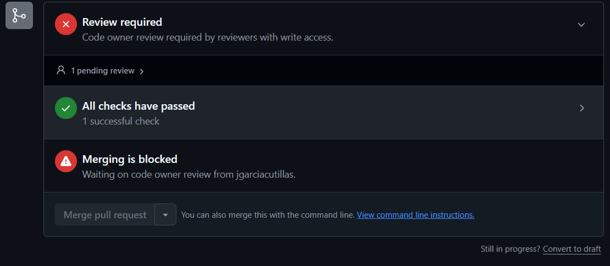

Ahora cambiaremos una test para provocar errores en el CI. Por lo que podremos ver el caso en que el pipeline falle.

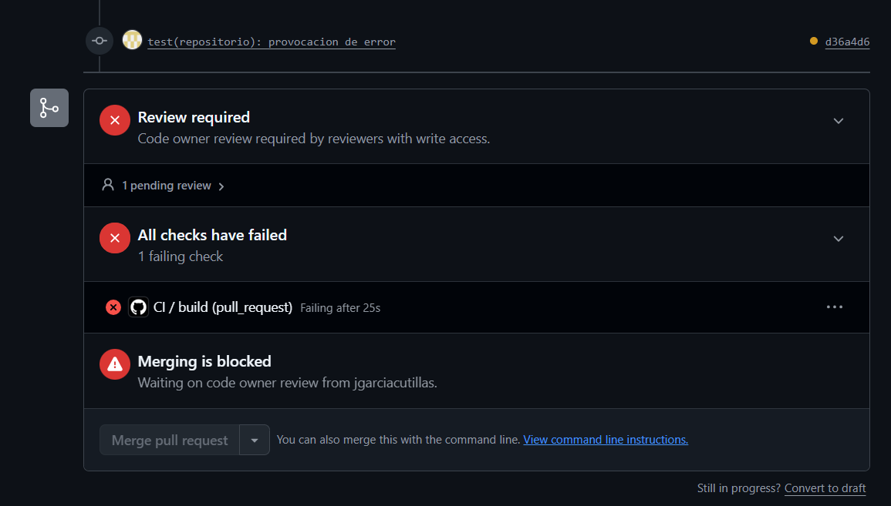

Por lo que arreglar el test, que es basicamente dejar el test en su estado inicial, una vez hecho el push, el pipeline del PR pasa todos los checks.

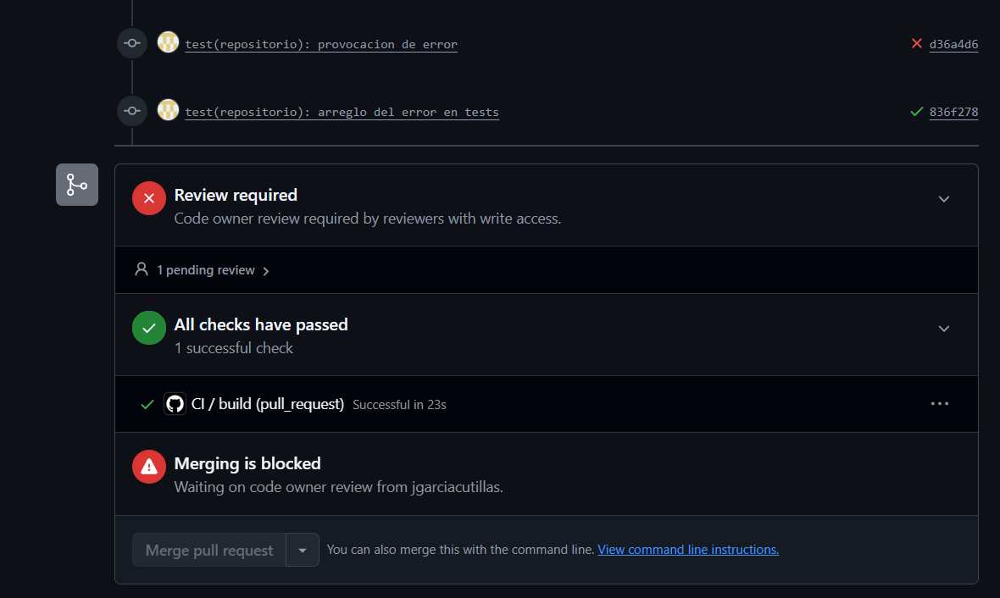


### Parte C - Separar responsabilidades en jobs
En este apartado se separa cada responsabilidad en un job distinto que permita distinguir donde realmente ha sucedido el error. Se provoca un fallo de formato para comprobar que el job `lint` falle.

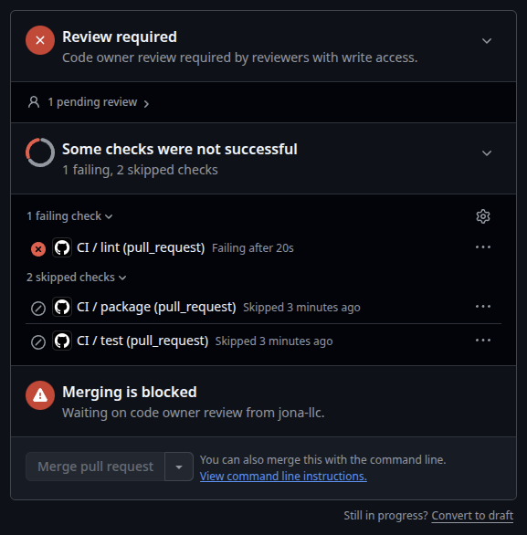

Es útil que `lint` vaya primero debido a que la verificación del formato es rápida (segundos) al contrario de `mvn verify` que puede llegar a tardar minutos. Además, si el código no cumple Spotless el workflow se detiene ahí y no desperdicia tiempo de ejecución de GitHub Actions. Por defecto, GitHub se salta el resto de pasos cuando falla el primero. Sin embargo, `if: always()` permite que pase lo que pase se ejecute ese paso con independencia del resultado del resto de pasos.

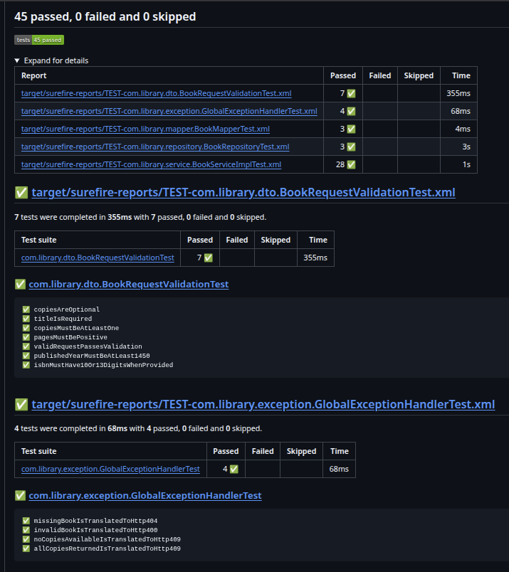
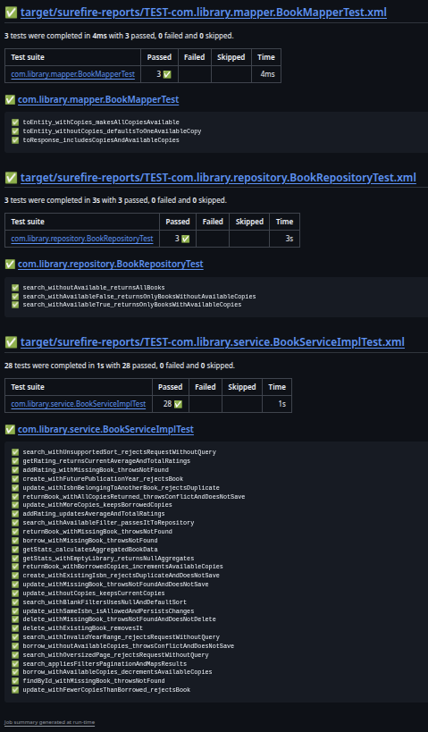
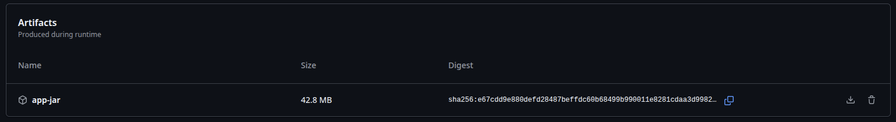

El job package vuelve a construir el proyecto debido a que cada runner es una máquina virtual distinta con discos distintos. Para poder compartir los ficheros un job debería subir el fichero y el siguiente lo descarga utilizando `actions/upload-artifact@v4` y `actions/download-artifact@v4`

### Parte D - Convertir el CI en una barrera

Mediante la configuración del repositorio, hemos creado una barrera para que si no pasa todos los test, no se puede hacer merge a la rama main.

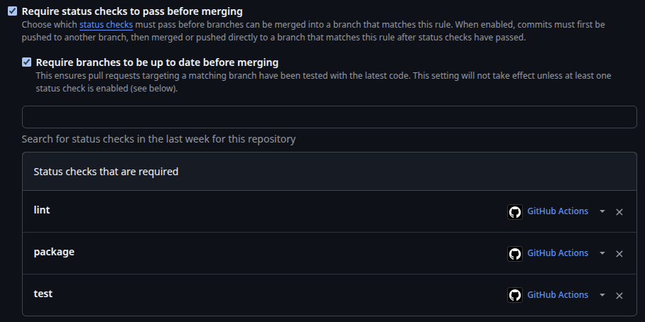

Por lo que aunque el revisor haya dado el aprobado a nuestro codigo, ya no nos permite hacer `merge`, a menos que haya pasado todos los checks del pipeline.

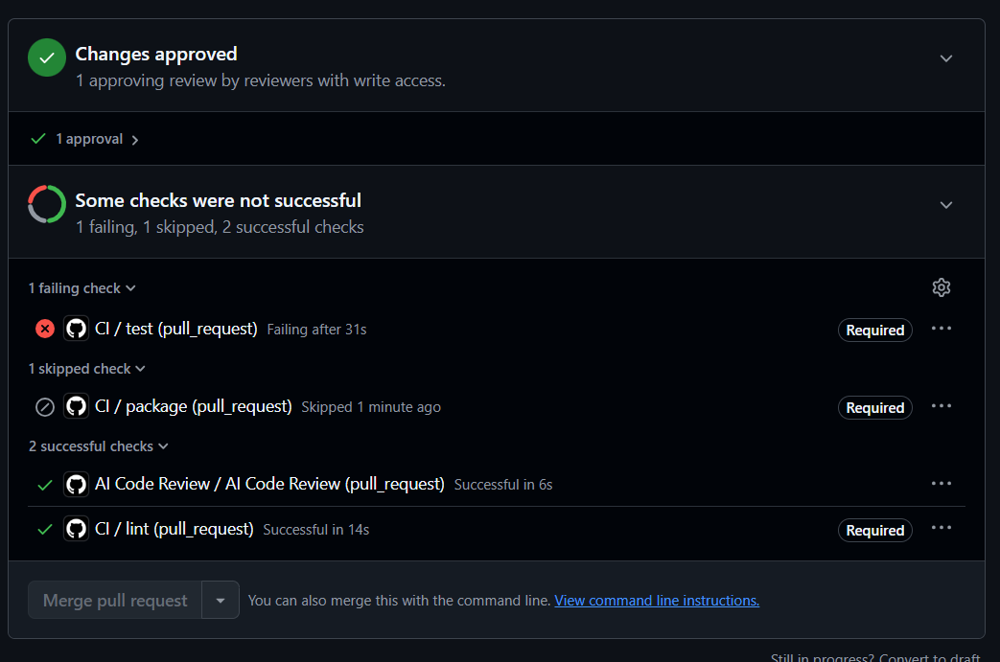

### Parte E - Ampliaciones interesantes

Creamos la API KEY usando la key que nos proporciona Ollama Cloud y lo añadimos a los secrets del repositorio para poder emplearlo.
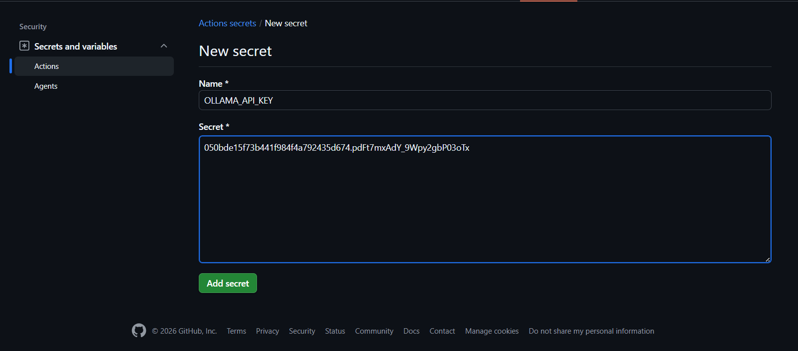

Una vez hecho ese proceso, creamos un workflow que use dicha key para pedirle a la IA que realice un resumen sobre lo que se ha cambiado en el repositorio.

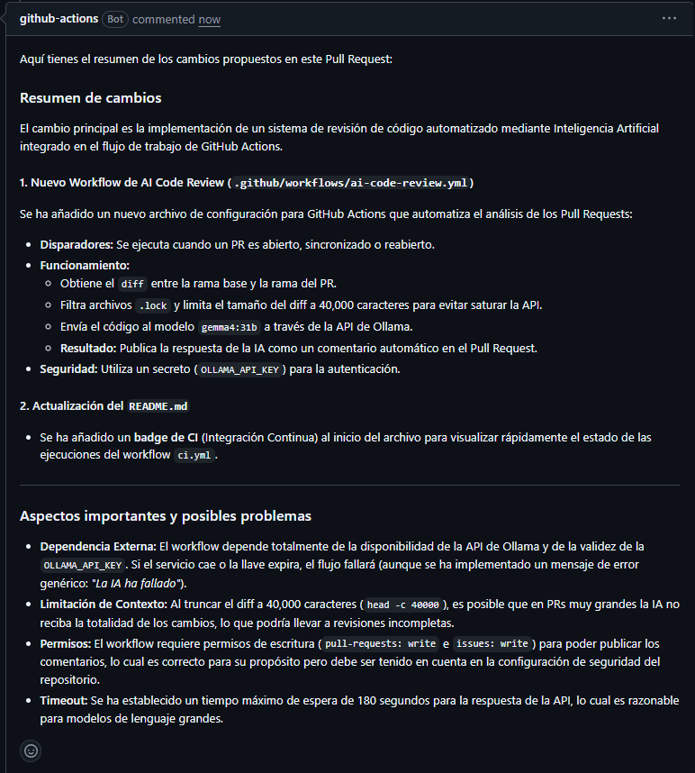
