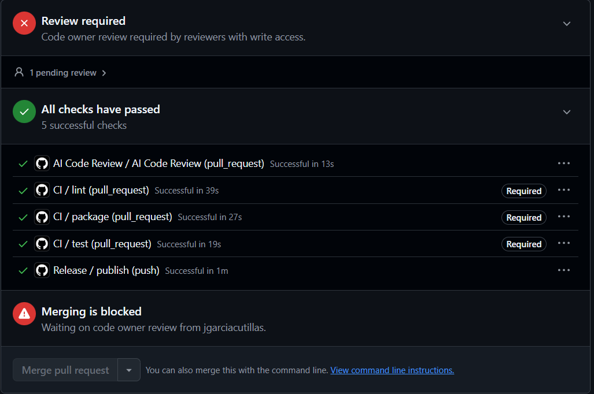
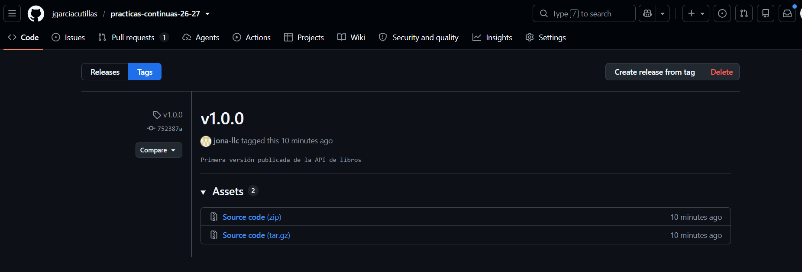
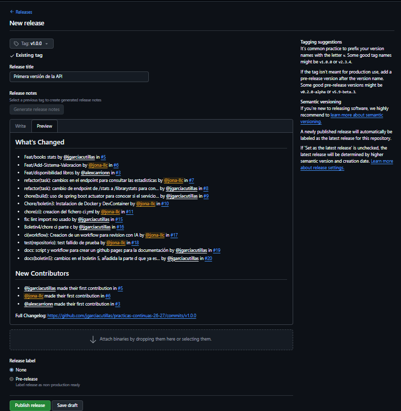

# Boletin 5

## Resumen de commits

| # | Mensaje del commit | Qué se hizo | Autor | Enlace |
|---|--------------------|-------------|-------|--------|
| 1 | `docs: script y workflow para crear un github pages para la documentación` | Creación de script y workflow para publicar una página | Javier García Cutillas | [f7fffae]([url](https://github.com/jgarciacutillas/practicas-continuas-26-27/commit/f7fffaeaa6cda3a2ca29c948a72d0ddddefa9134)) |

## Detalle por commit

### 1. `docs: script y workflow para crear un github pages para la documentación`
- **Qué se hizo:** Creación de script y workflow para publicar una página en la que se pueden observar todos los boletines realizados durante este periodo. Se puede observar a través de esta [url](https://jgarciacutillas.github.io/practicas-continuas-26-27/).
- **Autor:** Javier García Cutillas
- **Relación con el boletín:** Parte D - GitHub Pages de la documentación
- **Uso de IA:** Claude

#### Prompt
```bash
generame el script: Como dice el [Boletín 0](https://practicas-continuas-umu.github.io/apuntes/practicas/boletin0-guia-del-curso.html), has ido guardando la memoria de cada sesión (`boletinX.md`) en un repositorio/carpeta aparte. Toca traerla al repositorio de la API y publicarla como una web navegable.

* Copia (o mueve) tus `boletinX.md` desde el repositorio donde los tenías a una carpeta `docs/` en la raíz del repositorio de la API, uno por sesión entregada hasta ahora (`docs/boletin1.md` … `docs/boletin5.md`).
* Dentro de `docs/`, escribe un script (node o python) que lea todos los `.md` de `docs/` y genere, para cada uno, un `.html` equivalente más un `index.html` que enlace a todos. Deben guardarse en `docs/site/`. Recomiendo usar la IA para esto.
* Prueba el script en local y revisa el resultado abriendo el HTML en el navegador.
```

```bash
cada boletin es una carpeta con fotos y el .md dentro
```

```bash
* Automatízalo con un workflow `.github/workflows/pages.yml` que, en cada push a `main`, ejecute el script y publique `docs/site/` en GitHub Pages con las acciones oficiales.
```

```bash
moidifca el build-site.mjs que sea bonito y minimalista
```

## Descripción narrativa de lo hecho en la sesión y relación con los commits

### Parte A - Pipeline de publicación

Creamos el workflow correspondiente que se ejecutara al fusionar una rama a `main` o cuando publiquemos una nueva version
```yml
name: Release

on:
  push:
    branches: [ main ]
    tags: [ "v*.*.*" ]

permissions:
  contents: read
  packages: write

jobs:
  publish:
    runs-on: ubuntu-latest
    timeout-minutes: 20
    steps:
      - uses: actions/checkout@v4

      - name: Login en GHCR
        uses: docker/login-action@v3
        with:
          registry: ghcr.io
          username: ${{ github.actor }}
          password: ${{ secrets.GITHUB_TOKEN }}

      - name: Metadatos (tags)
        id: meta
        uses: docker/metadata-action@v5
        with:
          images: ghcr.io/${{ github.repository }}
          tags: |
            type=sha,prefix=sha-
            type=semver,pattern={{version}}
            type=semver,pattern={{major}}.{{minor}}
            type=semver,pattern={{major}}
            type=raw,value=latest,enable={{is_default_branch}}

      - name: Construir y publicar
        uses: docker/build-push-action@v6
        with:
          context: .
          push: true
          tags: ${{ steps.meta.outputs.tags }}
          labels: ${{ steps.meta.outputs.labels }}
``` 

**Explica qué ocurre en estas dos ocasiones:** 

**1) al fusionar un PR a main** 

Cuando se fusiona un PR a main, se genera un push a esa rama y se ejecuta el workflow. Y además con el step `Construir y publicar`, se generan distintas etiquetas para la imagen, sha-`<commit>` consiguiendo una trazabilidad absoluta de la imagen al commit que la produjo; además se genera la etiqueta `latest` porque se hace fusión a `main`, que se trata de nuestra rama principal. Y no se generan etiquetas de version porque este evento no corresponde a una etiqueta Git de versión.

**2) al publicar una etiqueta vX.Y.Z. ¿Qué tags de imagen se generan en cada caso y por qué?**

Cuando publicamos una etiquet vX.Y.Z, se ejecuta el workflow ya que coincide con el patrón `v*.*.*`, y se generarian las siguiente etiquetas, sha-`<commit>`, y las etiquetas de versión, `X.Y.Z` para la version completa, `X.Y` para la versión mayor y menor; y `X` para la versión mayor. Sin embargo, no se genera una etiqueta `latest`, ya que dependemos de `enable={{is_default_branch}}` que evalua si el evento ocurre en una rama predeterminada, y al publicar unicamente la etiqueta, este flag normalmente será falso.

**Comprueba que la imagen aparece en la pestaña Packages del repositorio, etiquetada con el SHA del commit y con latest.**


### Parte B - Publicar una versión de verdad

Para la publicación de una versión, en este caso, la primera versión de nuestra API de libros, usamos los siguientes comandos:

```bash
git tag -a v1.0.0 -m "Primera versión publicable de la API de tareas"
git push origin v1.0.0
```

Al hacer un push de la etiqueta de versión, vemos que salta el workflow porque se ha producido el evento de publicación de versión.



Y también vemos como la imagen tiene dicha etiqueta.



Y finalmente, creamos un Release a partir de esa etiqueta de versión, en el que describimos con notas todos los cambios hechos en esa versión, y para este caso, hemos utilizado la opción "Genereate release notes".



### Parte C - Verificar la imagen publicada


### Parte D - GitHub Pages de la documentación
Se ha creado un script y un workflow con Claude para crear y actualizar de manera dinámica, cada vez que se realiza un merge a main.


