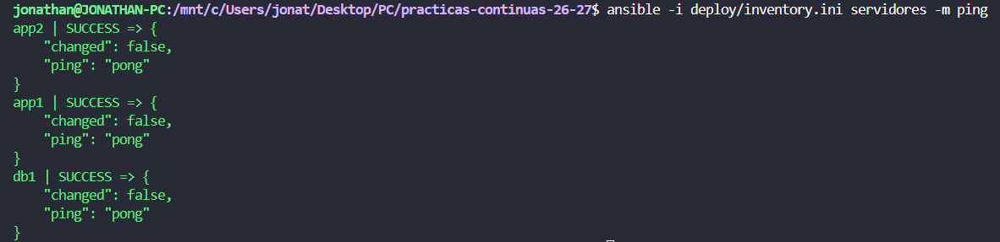

# Boletin 6

## Resumen de commits

| # | Mensaje del commit | Qué se hizo | Autor | Enlace |
|---|--------------------|-------------|-------|--------|
| 1 | `commit` | se_hizo_algo | nombre | [hash_commit](url) |
| 2 | `commit` | se_hizo_algo | nombre | [hash_commit](url) |
| 3 | `commit` | se_hizo_algo | nombre | [hash_commit](url) |

## Detalle por commit

### 1. `mensaje_del_commit`
- **Qué se hizo:** se_hizo_algo 
- **Autor:** nombre
- **Relación con el boletín:** parte_z_hola
- **Uso de IA:** no_se_ha_usado

### 2. `mensaje_del_commit`
- **Qué se hizo:** se_hizo_algo 
- **Autor:** nombre
- **Relación con el boletín:** parte_z_hola
- **Uso de IA:** ia_usada_chatgpt_claude_gemini

#### Prompt
```bash
prompt
```

## Descripción narrativa de lo hecho en la sesión y relación con los commits

### Parte A - Instalar Ansible y sus dependencias

Instalamos Ansible en nuestro equipo mediante el siguiente comando
```bash
sudo apt install ansible
```
Y comprobamos que se instaló de forma correcta.

```bash
$ ansible --version
ansible [core 2.20.1]
  config file = None
  configured module search path = ['/home/jonathan/.ansible/plugins/modules', '/usr/share/ansible/plugins/modules']
  ansible python module location = /usr/lib/python3/dist-packages/ansible
  ansible collection location = /home/jonathan/.ansible/collections:/usr/share/ansible/collections
  executable location = /usr/bin/ansible
  python version = 3.14.4 (main, Aug 20 2026, 10:41:58) [GCC 15.2.0] (/usr/bin/python3)
  jinja version = 3.1.6
  pyyaml version = 6.0.3 (with libyaml v0.2.5)
```
Y finalmente instalamos la collection que aporta los modulos de Docker
```bash
ansible-galaxy collection install community.docker:3.7.0
```

Y declaramos la siguiente dependencia del repositorio en `deploy/requirements.yml`.
```yml
collections:
  - name: community.docker
    version: "3.7.0"
```

### Parte B - Preparar la flota de servidores destino

Primero creamos las tres contenedores, habilitando SSH y accesible mediante distintos puertos del anfitrion. Para ellos creamos el fichero `docker-compose.yml` en `deploy/servidores`.
```yml
# deploy/servidores/docker-compose.yml
# Simula tu infraestructura: NO tiene nada que ver con el docker-compose.yml
# de la app (Boletín 3). Esto son las "máquinas" a las que Ansible se conectará por SSH.
services:
  app1:
    image: rastasheep/ubuntu-sshd:18.04   # Ubuntu con sshd ya arrancado
    container_name: app1
    privileged: true            # necesario: dentro correrá su propio Docker
    ports:
      - "2223:22"
      - "8081:8080"   # aquí quedará la API una vez desplegada dentro

  app2:
    image: rastasheep/ubuntu-sshd:18.04
    container_name: app2
    privileged: true
    ports:
      - "2224:22"
      - "8082:8080"

  db1:
    image: rastasheep/ubuntu-sshd:18.04
    container_name: db1
    privileged: true
    ports: [ "2225:22" ]  
```
Una vez creado el `docker-compose.yml` lanzamos los contenedores para su despliegue.
```bash
docker compose -f deploy/servidores/docker-compose.yml up -d

ssh root@localhost -p 2223   # app1 (contraseña: root)
ssh root@localhost -p 2224   # app2
ssh root@localhost -p 2225   # db1
```
Y finalmente comprobamos que nos podemos conectar mediante SSH y utilizando la contraseña `root` en los tres contenedores, podemos acceder a los contenedores.

- Acceso mediante SSH a `app1`:


- Acceso mediante SSH a `app2`:


- Acceso mediante SSH a `db1`:


### Parte C - El inventario

Creamos el fichero en `deploy/inventory.ini`.
```ini
[app]
app1 ansible_host=localhost ansible_port=2223 ansible_user=root
app2 ansible_host=localhost ansible_port=2224 ansible_user=root

[db]
db1 ansible_host=localhost ansible_port=2225 ansible_user=root

[servidores:children]
app
db

[servidores:vars]
ansible_python_interpreter=/usr/bin/python3
ansible_password=root
ansible_ssh_common_args='-o StrictHostKeyChecking=no -o UserKnownHostsFile=/dev/null'
```

Ademas, al no contar con `sshpass`, lo instalamos con el siguiente comando

```bash
sudo apt install -y sshpass
```
Y comprobamos que se realiza la conexión con `ping` de Ansible a toda la flota, ya que nos responden con un `pong`.



### Parte D - El playbook de despliegue

Instalamos Docker en toda la flota de Ansible, deplegamos la base de datos `db` y la aplicación `app` mediante `deploy/deploy.yml`, indicando en el fichero la imagen de nuestro repositorio creado en el boletin 5.

```yml
- name: Preparar Docker en toda la flota
  hosts: servidores
  tasks:
    - name: Instalar Docker y el SDK de Python
      apt:
        name: [ docker.io, python3-docker ]
        state: present
        update_cache: true

    - name: Arrancar dockerd (los contenedores no tienen systemd)
      shell: |
        nohup dockerd > /var/log/dockerd.log 2>&1 &
        for i in $(seq 1 30); do docker info >/dev/null 2>&1 && exit 0; sleep 1; done
        cat /var/log/dockerd.log
        exit 1
      args:
        creates: /var/run/docker.pid


- name: Desplegar la base de datos
  hosts: db
  tasks:
    - name: Base de datos PostgreSQL
      community.docker.docker_container:
        name: tareas-db
        image: postgres:16
        state: started
        restart_policy: always
        network_mode: host             
        volumes: [ "tareas-db-data:/var/lib/postgresql/data" ]
        env:
          POSTGRES_DB: "{{ db_name }}"
          POSTGRES_USER: "{{ db_user }}"
          POSTGRES_PASSWORD: "{{ db_pass }}"
        healthcheck:
          test: [ "CMD-SHELL", "pg_isready -U {{ db_user }}" ]
          interval: 5s
          retries: 10

- name: Desplegar la API de tareas
  hosts: app
  vars:
    version_app: "1.0.0"                                   # se sobreescribe desde el CI
    imagen: "ghcr.io/jgarciacutillas/practicas-continuas-26-27:{{ version_app }}"
    host_bd: "{{ groups['db'][0] }}"                        # primer host del grupo db

  tasks:
    - name: Login en GHCR
      community.docker.docker_login:
        registry_url: ghcr.io
        username: "{{ ghcr_user }}"
        password: "{{ ghcr_token }}"

    - name: Descargar la imagen de la aplicación
      community.docker.docker_image:
        name: "{{ imagen }}"
        source: pull

    - name: Arrancar el contenedor de la API
      community.docker.docker_container:
        name: tareas-api
        image: "{{ imagen }}"
        state: started
        recreate: false          # idempotencia: no lo toca si ya es esta versión
        restart_policy: always
        network_mode: host       # comparte red con esta máquina: así ve a "{{ host_bd }}" por su nombre
        env:
          SPRING_DATASOURCE_URL: "jdbc:postgresql://{{ host_bd }}:5432/{{ db_name }}"
          SPRING_DATASOURCE_USERNAME: "{{ db_user }}"
          SPRING_DATASOURCE_PASSWORD: "{{ db_pass }}"

    - name: Smoke test — esperar a que la API esté sana
      uri:
        url: "http://localhost:8080/actuator/health"
        status_code: 200
      register: salud
      retries: 20
      delay: 5
      until: salud.json.status is defined and salud.json.status == "UP"
```

### Parte E - Proteger las credenciales con Ansible Vault


### Parte F - Ejecutar el despliegue a mano


### Parte G - Disparar el despliegue desde GitHub Actions (cierre CD)

