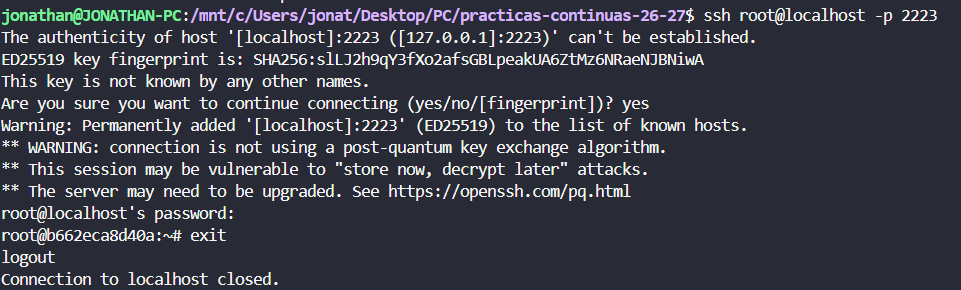
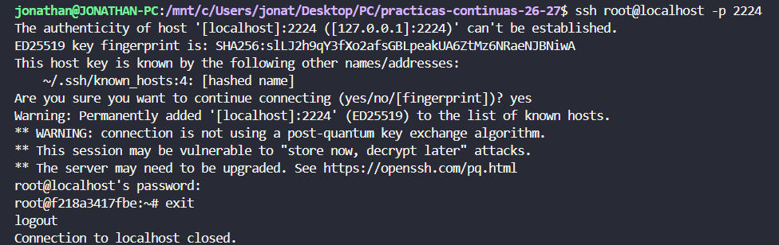
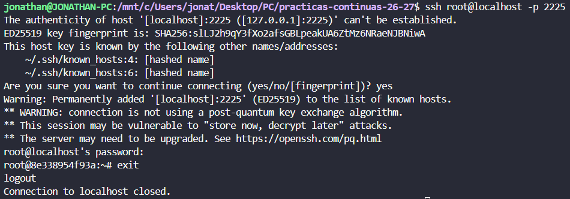

# Boletin 6

## Resumen de commits

| # | Mensaje del commit | Qué se hizo | Autor | Enlace |
|---|--------------------|-------------|-------|--------|
| 1 | `commit` | se_hizo_algo | nombre | [hash_commit](url) |
| 2 | `commit` | se_hizo_algo | nombre | [hash_commit](url) |
| 3 | `commit` | se_hizo_algo | nombre | [hash_commit](url) |

## Detalle por commit

### 1. `mensaje_del_commit`
- **Qué se hizo:** se_hizo_algo 
- **Autor:** nombre
- **Relación con el boletín:** parte_z_hola
- **Uso de IA:** no_se_ha_usado

### 2. `mensaje_del_commit`
- **Qué se hizo:** se_hizo_algo 
- **Autor:** nombre
- **Relación con el boletín:** parte_z_hola
- **Uso de IA:** ia_usada_chatgpt_claude_gemini

#### Prompt
```bash
prompt
```

## Descripción narrativa de lo hecho en la sesión y relación con los commits

### Parte A - Instalar Ansible y sus dependencias

Instalamos Ansible en nuestro equipo mediante el siguiente comando
```bash
sudo apt install ansible
```
Y comprobamos que se instaló de forma correcta.

```bash
$ ansible --version
ansible [core 2.20.1]
  config file = None
  configured module search path = ['/home/jonathan/.ansible/plugins/modules', '/usr/share/ansible/plugins/modules']
  ansible python module location = /usr/lib/python3/dist-packages/ansible
  ansible collection location = /home/jonathan/.ansible/collections:/usr/share/ansible/collections
  executable location = /usr/bin/ansible
  python version = 3.14.4 (main, Aug 20 2026, 10:41:58) [GCC 15.2.0] (/usr/bin/python3)
  jinja version = 3.1.6
  pyyaml version = 6.0.3 (with libyaml v0.2.5)
```
Y finalmente instalamos la collection que aporta los modulos de Docker
```bash
ansible-galaxy collection install community.docker:3.7.0
```

Y declaramos la siguiente dependencia del repositorio en `deploy/requirements.yml`.
```yml
collections:
  - name: community.docker
    version: "3.7.0"
```

### Parte B - Preparar la flota de servidores destino

Primero creamos las tres contenedores, habilitando SSH y accesible mediante distintos puertos del anfitrion. Para ellos creamos el fichero `docker-compose.yml` en `deploy/servidores`.
```yml
# deploy/servidores/docker-compose.yml
# Simula tu infraestructura: NO tiene nada que ver con el docker-compose.yml
# de la app (Boletín 3). Esto son las "máquinas" a las que Ansible se conectará por SSH.
services:
  app1:
    image: rastasheep/ubuntu-sshd:18.04   # Ubuntu con sshd ya arrancado
    container_name: app1
    privileged: true            # necesario: dentro correrá su propio Docker
    ports:
      - "2223:22"
      - "8081:8080"   # aquí quedará la API una vez desplegada dentro

  app2:
    image: rastasheep/ubuntu-sshd:18.04
    container_name: app2
    privileged: true
    ports:
      - "2224:22"
      - "8082:8080"

  db1:
    image: rastasheep/ubuntu-sshd:18.04
    container_name: db1
    privileged: true
    ports: [ "2225:22" ]  
```
Una vez creado el `docker-compose.yml` lanzamos los contenedores para su despliegue.
```bash
docker compose -f deploy/servidores/docker-compose.yml up -d

ssh root@localhost -p 2223   # app1 (contraseña: root)
ssh root@localhost -p 2224   # app2
ssh root@localhost -p 2225   # db1
```
Y finalmente comprobamos que nos podemos conectar mediante SSH y utilizando la contraseña `root` en los tres contenedores, podemos acceder a los contenedores.

- Acceso mediante SSH a `app1`:



- Acceso mediante SSH a `app2`:



- Acceso mediante SSH a `db`:



### Parte C - El inventario


### Parte D - El playbook de despliegue


### Parte E - Proteger las credenciales con Ansible Vault


### Parte F - Ejecutar el despliegue a mano


### Parte G - Disparar el despliegue desde GitHub Actions (cierre CD)

