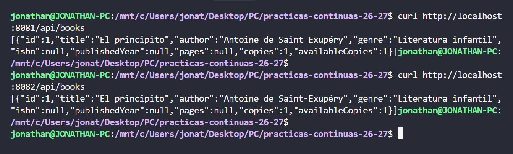

# Boletin 6

## Resumen de commits

| # | Mensaje del commit | Qué se hizo | Autor | Enlace |
|---|--------------------|-------------|-------|--------|
| 1 | `commit` | se_hizo_algo | nombre | [hash_commit](url) |
| 2 | `commit` | se_hizo_algo | nombre | [hash_commit](url) |
| 3 | `commit` | se_hizo_algo | nombre | [hash_commit](url) |

## Detalle por commit

### 1. `mensaje_del_commit`
- **Qué se hizo:** se_hizo_algo 
- **Autor:** nombre
- **Relación con el boletín:** parte_z_hola
- **Uso de IA:** no_se_ha_usado

### 2. `mensaje_del_commit`
- **Qué se hizo:** se_hizo_algo 
- **Autor:** nombre
- **Relación con el boletín:** parte_z_hola
- **Uso de IA:** ia_usada_chatgpt_claude_gemini

#### Prompt
```bash
prompt
```

## Descripción narrativa de lo hecho en la sesión y relación con los commits

### Parte A - Instalar Ansible y sus dependencias

Instalamos Ansible en nuestro equipo mediante el siguiente comando
```bash
sudo apt install ansible
```
Y comprobamos que se instaló de forma correcta.

```bash
$ ansible --version
ansible [core 2.20.1]
  config file = None
  configured module search path = ['/home/jonathan/.ansible/plugins/modules', '/usr/share/ansible/plugins/modules']
  ansible python module location = /usr/lib/python3/dist-packages/ansible
  ansible collection location = /home/jonathan/.ansible/collections:/usr/share/ansible/collections
  executable location = /usr/bin/ansible
  python version = 3.14.4 (main, Aug 20 2026, 10:41:58) [GCC 15.2.0] (/usr/bin/python3)
  jinja version = 3.1.6
  pyyaml version = 6.0.3 (with libyaml v0.2.5)
```
Y finalmente instalamos la collection que aporta los modulos de Docker
```bash
ansible-galaxy collection install community.docker:3.7.0
```

Y declaramos la siguiente dependencia del repositorio en `deploy/requirements.yml`.
```yml
collections:
  - name: community.docker
    version: "3.7.0"
```

### Parte B - Preparar la flota de servidores destino

Primero creamos las tres contenedores, habilitando SSH y accesible mediante distintos puertos del anfitrion. Para ellos creamos el fichero `docker-compose.yml` en `deploy/servidores`.
```yml
# deploy/servidores/docker-compose.yml
# Simula tu infraestructura: NO tiene nada que ver con el docker-compose.yml
# de la app (Boletín 3). Esto son las "máquinas" a las que Ansible se conectará por SSH.
services:
  app1:
    image: rastasheep/ubuntu-sshd:18.04   # Ubuntu con sshd ya arrancado
    container_name: app1
    privileged: true            # necesario: dentro correrá su propio Docker
    ports:
      - "2223:22"
      - "8081:8080"   # aquí quedará la API una vez desplegada dentro

  app2:
    image: rastasheep/ubuntu-sshd:18.04
    container_name: app2
    privileged: true
    ports:
      - "2224:22"
      - "8082:8080"

  db1:
    image: rastasheep/ubuntu-sshd:18.04
    container_name: db1
    privileged: true
    ports: [ "2225:22" ]  
```
Una vez creado el `docker-compose.yml` lanzamos los contenedores para su despliegue.
```bash
docker compose -f deploy/servidores/docker-compose.yml up -d

ssh root@localhost -p 2223   # app1 (contraseña: root)
ssh root@localhost -p 2224   # app2
ssh root@localhost -p 2225   # db1
```
Y finalmente comprobamos que nos podemos conectar mediante SSH y utilizando la contraseña `root` en los tres contenedores, podemos acceder a los contenedores.

- Acceso mediante SSH a `app1`:


- Acceso mediante SSH a `app2`:


- Acceso mediante SSH a `db1`:


### Parte C - El inventario

Creamos el fichero en `deploy/inventory.ini`.
```ini
[app]
app1 ansible_host=localhost ansible_port=2223 ansible_user=root
app2 ansible_host=localhost ansible_port=2224 ansible_user=root

[db]
db1 ansible_host=localhost ansible_port=2225 ansible_user=root

[servidores:children]
app
db

[servidores:vars]
ansible_python_interpreter=/usr/bin/python3
ansible_password=root
ansible_ssh_common_args='-o StrictHostKeyChecking=no -o UserKnownHostsFile=/dev/null'
```

Ademas, al no contar con `sshpass`, lo instalamos con el siguiente comando

```bash
sudo apt install -y sshpass
```
Y comprobamos que se realiza la conexión con `ping` de Ansible a toda la flota, ya que nos responden con un `pong`.


### Parte D - El playbook de despliegue

Instalamos Docker en toda la flota de Ansible, deplegamos la base de datos `db` y la aplicación `app` mediante `deploy/deploy.yml`, indicando en el fichero la imagen de nuestro repositorio creado en el boletin 5.

```yml
- name: Preparar Docker en toda la flota
  hosts: servidores
  tasks:
    - name: Instalar Docker y el SDK de Python
      apt:
        name: [ docker.io, python3-docker ]
        state: present
        update_cache: true

    - name: Arrancar dockerd (los contenedores no tienen systemd)
      shell: |
        nohup dockerd > /var/log/dockerd.log 2>&1 &
        for i in $(seq 1 30); do docker info >/dev/null 2>&1 && exit 0; sleep 1; done
        cat /var/log/dockerd.log
        exit 1
      args:
        creates: /var/run/docker.pid


- name: Desplegar la base de datos
  hosts: db
  tasks:
    - name: Base de datos PostgreSQL
      community.docker.docker_container:
        name: books
        image: postgres:16
        state: started
        restart_policy: always
        network_mode: host             
        volumes: [ "books-data:/var/lib/postgresql/data" ]
        env:
          POSTGRES_DB: "{{ db_name }}"
          POSTGRES_USER: "{{ db_user }}"
          POSTGRES_PASSWORD: "{{ db_pass }}"
        healthcheck:
          test: [ "CMD-SHELL", "pg_isready -U {{ db_user }}" ]
          interval: 5s
          retries: 10

- name: Desplegar la API de libros
  hosts: app
  vars:
    version_app: "1.0.0"                                   # se sobreescribe desde el CI
    imagen: "ghcr.io/jgarciacutillas/practicas-continuas-26-27:{{ version_app }}"
    host_bd: "{{ groups['db'][0] }}"                        # primer host del grupo db

  tasks:
    - name: Login en GHCR
      community.docker.docker_login:
        registry_url: ghcr.io
        username: "{{ ghcr_user }}"
        password: "{{ ghcr_token }}"

    - name: Descargar la imagen de la aplicación
      community.docker.docker_image:
        name: "{{ imagen }}"
        source: pull

    - name: Arrancar el contenedor de la API
      community.docker.docker_container:
        name: books-api
        image: "{{ imagen }}"
        state: started
        recreate: false          # idempotencia: no lo toca si ya es esta versión
        restart_policy: always
        network_mode: host       # comparte red con esta máquina: así ve a "{{ host_bd }}" por su nombre
        env:
          SPRING_DATASOURCE_URL: "jdbc:postgresql://{{ host_bd }}:5432/{{ db_name }}"
          SPRING_DATASOURCE_USERNAME: "{{ db_user }}"
          SPRING_DATASOURCE_PASSWORD: "{{ db_pass }}"

    - name: Smoke test — esperar a que la API esté sana
      uri:
        url: "http://localhost:8080/actuator/health"
        status_code: 200
      register: salud
      retries: 20
      delay: 5
      until: salud.json.status is defined and salud.json.status == "UP"
```

### Parte E - Proteger las credenciales con Ansible Vault

Para proteger ciertos valores que no podemos dejar en el fichero `deploy/deploy.yml` usamos Ansible Vault para proteger dichas crendenciales.

Para ellos empleamos el siguiente comando para crear un archivo cifrado.
```bash
ansible-vault create deploy/group_vars/servidores/vault.yml
```

En el que ponemos el siguiente contenido adaptandola de forma necesaria a nuestros datos.
```bash
ghcr_user: TU_USUARIO
ghcr_token: ghp_xxxxxxxxxxxx
db_name: books
db_user: app
db_pass: una_clave_larga
```
- Comprueba con `cat` que el archivo versionado es ilegible.

Y con el comando `cat` podemos ver como no podemos leer el contenido del vault ya que estaria cifrado.
```bash
jonathan@JONATHAN-PC:/mnt/c/Users/jonat/Desktop/PC/practicas-continuas-26-27$ cat deploy/group_vars/servidores/vault.yml 
$ANSIBLE_VAULT;1.1;AES256
34633939346538326133633064323236326662373232373039363638353336343261623230633564
6131373338383737323937383630656664646235633837310a313131323263363563643539363332
65666334393564356661363462656231366337613431646335643562363236306337376461656664
3166663933396538380a353536386464616532393436326363306635323362363161346531646530
63656234376637646432316462666433626363323434643837343330326638663465643464663161
62393563643330386530316332343038356631376662343239303331626336653463333230303534
63343734383130636366396335656437306239373837386531313431646666303361383832313539
35613563656337333963646130633832363965653732656466333866643433383266393234656137
31306365313463626638393837373539616631666563313863633537323761333437373966636433
35636236353236313232626131316133623332363166353936623461643635373662623965386232
326538323365633536333536303666386663
```


### Parte F - Ejecutar el despliegue a mano
Para el despligue a mano, utilizamos el siguiente comando

```bash
jonathan@JONATHAN-PC:/mnt/c/Users/jonat/Desktop/PC/practicas-continuas-26-27$ ansible-playbook -i deploy/inventory.ini deploy/deploy.yml --ask-vault-pass --extra-vars "version_app=1.0.0"
Vault password: 

PLAY [Preparar Docker en toda la flota] ******************************************************************************************************************************

TASK [Gathering Facts] ***********************************************************************************************************************************************
ok: [app2]
ok: [db1]
ok: [app1]

TASK [Instalar Docker y el SDK de Python] ****************************************************************************************************************************
changed: [app2]
changed: [app1]
changed: [db1]

TASK [Arrancar dockerd (los contenedores no tienen systemd)] *********************************************************************************************************
changed: [app2]
changed: [app1]
changed: [db1]

PLAY [Desplegar la base de datos] ************************************************************************************************************************************

TASK [Gathering Facts] ***********************************************************************************************************************************************
ok: [db1]

TASK [Base de datos PostgreSQL] **************************************************************************************************************************************
changed: [db1]

PLAY [Desplegar la API de tareas] ************************************************************************************************************************************

TASK [Gathering Facts] ***********************************************************************************************************************************************
ok: [app1]
ok: [app2]

TASK [Login en GHCR] *************************************************************************************************************************************************
changed: [app2]
changed: [app1]

TASK [Descargar la imagen de la aplicación] **************************************************************************************************************************
changed: [app1]
changed: [app2]

TASK [Arrancar el contenedor de la API] ******************************************************************************************************************************
changed: [app2]
changed: [app1]

TASK [Smoke test — esperar a que la API esté sana] *******************************************************************************************************************
FAILED - RETRYING: [app2]: Smoke test — esperar a que la API esté sana (20 retries left).
FAILED - RETRYING: [app1]: Smoke test — esperar a que la API esté sana (20 retries left).
FAILED - RETRYING: [app2]: Smoke test — esperar a que la API esté sana (19 retries left).
FAILED - RETRYING: [app1]: Smoke test — esperar a que la API esté sana (19 retries left).
ok: [app2]
ok: [app1]

PLAY RECAP ***********************************************************************************************************************************************************
app1                       : ok=8    changed=5    unreachable=0    failed=0    skipped=0    rescued=0    ignored=0   
app2                       : ok=8    changed=5    unreachable=0    failed=0    skipped=0    rescued=0    ignored=0   
db1                        : ok=5    changed=3    unreachable=0    failed=0    skipped=0    rescued=0    ignored=0
```
Una vez lanzado, observamos que todo arrancó correctamente, por lo que verificamos su estado para ver si hablan con la misma base de datos `db1` (previamente se guardo el libro `El principito` para observar que si estan conectados con la misma base de datos).



Y de nuevo volvemos a ejecutar el mismo playbook, observando como al final de ejecucion, obtenemos para las tres maquinas el mismo resultado, **`changed=0`**; es decir, todo ya estaria en el estado deseado.

```bash
jonathan@JONATHAN-PC:/mnt/c/Users/jonat/Desktop/PC/practicas-continuas-26-27$ ansible-playbook -i deploy/inventory.ini deploy/deploy.yml   --ask-vault-pass --extra-vars "version_app=1.0.0"
Vault password: 

PLAY [Preparar Docker en toda la flota] ***************************************************************************************************************************

TASK [Gathering Facts] ********************************************************************************************************************************************
ok: [db1]
ok: [app1]
ok: [app2]

TASK [Instalar Docker y el SDK de Python] *************************************************************************************************************************
ok: [db1]
ok: [app1]
ok: [app2]

TASK [Arrancar dockerd (los contenedores no tienen systemd)] ******************************************************************************************************
ok: [db1]
ok: [app1]
ok: [app2]

PLAY [Desplegar la base de datos] *********************************************************************************************************************************

TASK [Gathering Facts] ********************************************************************************************************************************************
ok: [db1]

TASK [Base de datos PostgreSQL] ***********************************************************************************************************************************
ok: [db1]

PLAY [Desplegar la API de tareas] *********************************************************************************************************************************

TASK [Gathering Facts] ********************************************************************************************************************************************
ok: [app1]
ok: [app2]

TASK [Login en GHCR] **********************************************************************************************************************************************
ok: [app1]
ok: [app2]

TASK [Descargar la imagen de la aplicación] ***********************************************************************************************************************
ok: [app1]
ok: [app2]

TASK [Arrancar el contenedor de la API] ***************************************************************************************************************************
ok: [app1]
ok: [app2]

TASK [Smoke test — esperar a que la API esté sana] ****************************************************************************************************************
ok: [app1]
ok: [app2]

PLAY RECAP ********************************************************************************************************************************************************
app1                       : ok=8    changed=0    unreachable=0    failed=0    skipped=0    rescued=0    ignored=0   
app2                       : ok=8    changed=0    unreachable=0    failed=0    skipped=0    rescued=0    ignored=0   
db1                        : ok=5    changed=0    unreachable=0    failed=0    skipped=0    rescued=0    ignored=0   
```

Ahora desplegaremos una versión nueva, en este paso publicamos `v.1.1.0` y usamos `--extra-vars "version_app=1.1.0"` y lo lanzammos.
```bash
jonathan@JONATHAN-PC:/mnt/c/Users/jonat/Desktop/PC/practicas-continuas-26-27$ ansible-playbook -i deploy/inventory.ini deploy/deploy.yml   --ask-vault-pass --extra-vars "version_app=1.1.0"
Vault password: 

PLAY [Preparar Docker en toda la flota] ***************************************************************************************************************************

TASK [Gathering Facts] ********************************************************************************************************************************************
ok: [app2]
ok: [app1]
ok: [db1]

TASK [Instalar Docker y el SDK de Python] *************************************************************************************************************************
ok: [db1]
ok: [app2]
ok: [app1]

TASK [Arrancar dockerd (los contenedores no tienen systemd)] ******************************************************************************************************
ok: [app2]
ok: [app1]
ok: [db1]

PLAY [Desplegar la base de datos] *********************************************************************************************************************************

TASK [Gathering Facts] ********************************************************************************************************************************************
ok: [db1]

TASK [Base de datos PostgreSQL] ***********************************************************************************************************************************
ok: [db1]

PLAY [Desplegar la API de tareas] *********************************************************************************************************************************

TASK [Gathering Facts] ********************************************************************************************************************************************
ok: [app1]
ok: [app2]

TASK [Login en GHCR] **********************************************************************************************************************************************
ok: [app2]
ok: [app1]

TASK [Descargar la imagen de la aplicación] ***********************************************************************************************************************
changed: [app2]
changed: [app1]

TASK [Arrancar el contenedor de la API] ***************************************************************************************************************************
[DEPRECATION WARNING]: The default value "ignore" for image_name_mismatch has been deprecated and will change to "recreate" in community.docker 4.0.0. In the current situation, this would cause the container to be recreated since the current container image name "ghcr.io/jgarciacutillas/practicas-continuas-26-27:1.0.0" does not match the desired image name "ghcr.io/jgarciacutillas/practicas-continuas-26-27:1.1.0". This feature will be removed from community.docker in version 4.0.0. Deprecation warnings can be disabled by setting deprecation_warnings=False in ansible.cfg.
changed: [app2]
changed: [app1]

TASK [Smoke test — esperar a que la API esté sana] ****************************************************************************************************************
FAILED - RETRYING: [app1]: Smoke test — esperar a que la API esté sana (20 retries left).
FAILED - RETRYING: [app2]: Smoke test — esperar a que la API esté sana (20 retries left).
FAILED - RETRYING: [app2]: Smoke test — esperar a que la API esté sana (19 retries left).
FAILED - RETRYING: [app1]: Smoke test — esperar a que la API esté sana (19 retries left).
ok: [app2]
ok: [app1]

PLAY RECAP ********************************************************************************************************************************************************
app1                       : ok=8    changed=2    unreachable=0    failed=0    skipped=0    rescued=0    ignored=0   
app2                       : ok=8    changed=2    unreachable=0    failed=0    skipped=0    rescued=0    ignored=0   
db1                        : ok=5    changed=0    unreachable=0    failed=0    skipped=0    rescued=0    ignored=0
```
Aunque no hayamos subidos cambios reales en la API, a excepcion de los ficheros Ansible para su despliegue, vemos que se han realizado cambios en `app1` y `app2` y ambos responden con la nueva versión. Y aunque no hayamos realizados cambios que se puedan observar, podemos saber que versión de la imagen utilizan dichas maquinas.

```bash
jonathan@JONATHAN-PC:/mnt/c/Users/jonat/Desktop/PC/practicas-continuas-26-27$ ansible app -i deploy/inventory.ini -m shell -a "docker inspect books-api --format '{{.Config.Image}}'" --ask-vault-pass
Vault password: 
app2 | CHANGED | rc=0 >>
ghcr.io/jgarciacutillas/practicas-continuas-26-27:1.1.0
app1 | CHANGED | rc=0 >>
ghcr.io/jgarciacutillas/practicas-continuas-26-27:1.1.0
```

Ahora volveremos a usar la `v1.0.0`, y para saber si tarda menos de 1 minuto en realizarse el rollback, usaremos el comando `time`.
```bash
jonathan@JONATHAN-PC:/mnt/c/Users/jonat/Desktop/PC/practicas-continuas-26-27$ time ansible-playbook -i deploy/inventory.ini deploy/deploy.yml   --ask-vault-pass --
extra-vars "version_app=1.0.0"
Vault password: 

PLAY [Preparar Docker en toda la flota] ***************************************************************************************************************************

TASK [Gathering Facts] ********************************************************************************************************************************************
ok: [app2]
ok: [db1]
ok: [app1]

TASK [Instalar Docker y el SDK de Python] *************************************************************************************************************************
ok: [db1]
ok: [app1]
ok: [app2]

TASK [Arrancar dockerd (los contenedores no tienen systemd)] ******************************************************************************************************
ok: [app1]
ok: [app2]
ok: [db1]

PLAY [Desplegar la base de datos] *********************************************************************************************************************************

TASK [Gathering Facts] ********************************************************************************************************************************************
ok: [db1]

TASK [Base de datos PostgreSQL] ***********************************************************************************************************************************
ok: [db1]

PLAY [Desplegar la API de libros] *********************************************************************************************************************************

TASK [Gathering Facts] ********************************************************************************************************************************************
ok: [app2]
ok: [app1]

TASK [Login en GHCR] **********************************************************************************************************************************************
ok: [app1]
ok: [app2]

TASK [Descargar la imagen de la aplicación] ***********************************************************************************************************************
ok: [app2]
ok: [app1]

TASK [Arrancar el contenedor de la API] ***************************************************************************************************************************

[DEPRECATION WARNING]: The default value "ignore" for image_name_mismatch has been deprecated and will change to "recreate" in community.docker 4.0.0. In the current situation, this would cause the container to be recreated since the current container image name "ghcr.io/jgarciacutillas/practicas-continuas-26-27:1.1.0" does not match the desired image name "ghcr.io/jgarciacutillas/practicas-continuas-26-27:1.0.0". This feature will be removed from community.docker in version 4.0.0. Deprecation warnings can be disabled by setting deprecation_warnings=False in ansible.cfg.

changed: [app1]
changed: [app2]

TASK [Smoke test — esperar a que la API esté sana] ****************************************************************************************************************
ok: [app2]
ok: [app1]

PLAY RECAP ********************************************************************************************************************************************************
app1                       : ok=8    changed=1    unreachable=0    failed=0    skipped=0    rescued=0    ignored=0   
app2                       : ok=8    changed=1    unreachable=0    failed=0    skipped=0    rescued=0    ignored=0   
db1                        : ok=5    changed=0    unreachable=0    failed=0    skipped=0    rescued=0    ignored=0   


real    0m34.068s
user    0m7.382s
sys     0m2.737s
```
Y observamos que el rollback para volver a la `v1.0.0` tarda menos de un minuto, en este caso 34 segundos.

### Parte G - Disparar el despliegue desde GitHub Actions (cierre CD)

